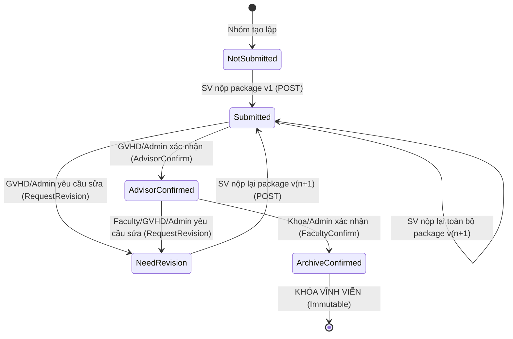

# Final submission archival API contract — SCRUM-106

Trạng thái: **CP1 đã triển khai POST nộp/nộp lại, sáu GET, schema/history/receipts và cleanup; xác nhận hai bước và producer ArchiveProof thuộc CP2**. Ngày 02/11/2026. Nền tảng kế thừa: [báo cáo cuối kỳ SCRUM-102](ThesisManagementApiContract.md), [duyệt GVHD SCRUM-103](AdvisorEvaluationApprovalApiContract.md), [phân công GVPB SCRUM-104](ReviewerAssignmentApiContract.md), [chấm GVPB và điều kiện bảo vệ SCRUM-105](ReviewerEvaluationApiContract.md). [Thiết kế schema/transaction/handoff](ArchivalScoreWorkflowDesign.md) là phần bắt buộc của contract này. Phạm vi và bằng chứng theo checkpoint tại [FinalSubmissionVerification](FinalSubmissionVerification.md). Plan local vẫn ngoài Git.

Phạm vi SCRUM-106:
- Sinh viên Confirmed của đúng nhóm nộp bộ hồ sơ lưu chiểu hoàn thiện sau bảo vệ gồm đúng một file PDF và đúng một file DOCX, mỗi file tối đa 20 MiB, kèm Abstract (Việt/Anh, tối đa 10.000 runes) và Keywords (Việt/Anh, tối đa 1.000 runes).
- Nộp lại khi `Submitted` hoặc `NeedRevision` tạo version mới của toàn bộ hồ sơ (package replacement nguyên vẹn), không thay đổi lẻ từng file hay metadata đã duyệt.
- Quy trình xác nhận hai bước:
  1. Bước 1: GVHD (hoặc Admin ghi actor thật) kiểm tra bản chỉnh sửa sau bảo vệ và xác nhận (`AdvisorConfirm`).
  2. Bước 2: Văn phòng Khoa (hoặc Admin ghi actor thật) kiểm tra tính hợp lệ và xác nhận hoàn thành lưu chiểu (`FacultyConfirm` -> trạng thái `ArchiveConfirmed`).
- Yêu cầu chỉnh sửa (`RequestRevision` -> trạng thái `NeedRevision`): GVHD được yêu cầu khi ở `Submitted` hoặc `AdvisorConfirmed` (chưa `ArchiveConfirmed`); Faculty được yêu cầu khi tiếp nhận hồ sơ đã `AdvisorConfirmed`. Bắt buộc có lý do (1–1.000 runes). Nộp lại tạo package version mới, làm mất hiệu lực xác nhận cũ đối với package mới nhưng bảo toàn lịch sử review.
- Trạng thái `ArchiveConfirmed` khóa vĩnh viễn hồ sơ (Frozen/Immutable), không cho phép sửa/nộp lại/thu hồi trong phạm vi hai task này.
- Cung cấp Archive Proof Contract cho module DefenseCouncil (SCRUM-110) để làm điều kiện tiên quyết khi tính điểm và công bố điểm.
- Hỗ trợ tra cứu hồ sơ nhóm sinh viên (`/my-group`), danh sách quản trị có phân trang/lọc, xem lịch sử các package và cấp URL tải file an toàn có thời hạn ngắn (presigned URL 5 phút).

Không bao gồm: UI SCRUM-114/115, xuất báo cáo PDF/Excel lưu chiểu, gửi email/thông báo bên ngoài, cấp quyền cho GVPB, mở khóa biên bản Hội đồng hoặc luồng thu hồi sau khi đã `ArchiveConfirmed`.

---

## 1. Quy ước HTTP và phân quyền

### 1.1. Quy ước chung
- Tất cả endpoint yêu cầu Bearer token.
- Envelope chuẩn `ApiResponse<T>`: `{ "success": true, "data": ..., "error": null }`. Khi có lỗi: `{ "success": false, "data": null, "error": { "code": "...", "message": "..." } }`.
- Thời gian định dạng ISO 8601 UTC (`yyyy-MM-ddTHH:mm:ss.fffZ`).
- Định danh nhận theo `Guid.TryParse`, khác GUID rỗng; không hạn chế riêng UUID v4.
- Số phiên bản `packageVersionNo` là số nguyên dương `int` >= 1; `expectedSubmissionVersion` là số nguyên `uint` > 0 biểu diễn concurrency token (`xmin`).
- Endpoint ghi nhận header `Idempotency-Key` định dạng UUID không rỗng ở **mọi môi trường** (kể cả Development và Integration Test).
- Request upload multipart nhận body tối đa 40 MiB + 256 KiB overhead (cấu hình `FormOptions` và Kestrel `MaxRequestBodySize` tương ứng).
- URL tải file dạng presigned có TTL 300 giây. Public DTO không trả trường ObjectKey/StorageKey riêng; đường dẫn trong URL ký sẵn có thể chứa object key theo cơ chế S3. Không cam kết che đường dẫn bằng proxy tải file trong task này.
- `groupId` là selector bắt buộc trong form POST và query của `/my-group`, `/submission-eligibility`. Backend xác minh Student + Active + Confirmed membership của chính group đó và suy ra batch; không tự chọn nhóm đầu tiên/mới nhất. Một SV có thể có nhóm ở nhiều đợt.
- GET theo submissionId suy ra group từ bản ghi rồi kiểm tra ownership; không nhận query groupId để ghi đè quan hệ đó. UUID/key/version/selector rỗng, sai kiểu hoặc trùng bị 400. Xác thực/phân quyền trước khi parse file hoặc tra cứu nội dung riêng tư.

### 1.2. Ma trận phân quyền

| Chủ thể | Nộp lần đầu/lại | AdvisorConfirm | FacultyConfirm | RequestRevision | GET /my-group | GET chi tiết/lịch sử | GET danh sách | Tải file |
| --- | --- | --- | --- | --- | --- | --- | --- | --- |
| **Student Confirmed** | NotSubmitted/Submitted/NeedRevision, Open, trong hạn | Không | Không | Không | Own group được chọn | Own group | Không | Own group |
| **GVHD hiện tại, Active/Lecturer** | Không | Submitted | Không | Submitted/AdvisorConfirmed | Chỉ nếu có nhánh Student hợp lệ | Nhóm đang hướng dẫn | Chỉ nhóm đang hướng dẫn | Nhóm đang hướng dẫn |
| **Faculty** | Chỉ nếu có nhánh Student hợp lệ | Không | AdvisorConfirmed + manage | AdvisorConfirmed + manage | Chỉ nếu có nhánh Student hợp lệ | read | read | read |
| **AcademicAffairs** | Chỉ nếu có nhánh Student hợp lệ | Không | Không | Không | Chỉ nếu có nhánh Student hợp lệ | read | read | read |
| **Admin** | Không nộp thay; chỉ nhánh Student hợp lệ | Submitted, actor thật | AdvisorConfirmed, actor thật | Submitted/AdvisorConfirmed, actor thật | Chỉ nhánh Student hợp lệ | Có | Có | Có |
| **GVPB/Lecturer khác** | Chỉ nếu có nhánh Student hợp lệ | Không | Không | Không | Chỉ nhánh Student hợp lệ | Không tự có quyền | Không | Không tự có quyền |
| **Ngoài phạm vi / Anonymous** | 403 / 401 | 403 / 401 | 403 / 401 | 403 / 401 | 403 / 401 | 403 / 401 | 403 / 401 | 403 / 401 |

**Quy tắc bảo mật và tài khoản đa vai trò:**
1. Sinh viên truyền `groupId` để chọn nhóm/đợt, không phải để tự cấp quyền. Luôn kiểm tra membership `Confirmed` của actor với đúng selector; sai nhóm trả 403 trước khi tiết lộ trạng thái hồ sơ. Không nhận studentId/userId do client chọn.
2. GVHD được xác thực qua phân công đề tài hiện tại từ `TopicCatalog`.
3. Faculty cần role `Faculty` và permission `thesis.final-submissions.manage` để xác nhận/yêu cầu sửa, permission `thesis.final-submissions.read` để đọc.
4. AcademicAffairs chỉ có quyền đọc (`thesis.final-submissions.read`) để giám sát, điều phối; không có quyền xác nhận hay yêu cầu sửa.
5. Admin thực hiện các thao tác xác nhận/yêu cầu sửa thay GVHD hoặc Khoa thì audit log và trường `advisor_confirmed_by` / `archived_confirmed_by` phải ghi đúng `UserId` thực tế của Admin, không giả mạo danh tính GVHD hay chuyên viên Khoa.
6. GVPB từ SCRUM-104 không tự động có quyền tải hay xem hồ sơ lưu chiểu; mọi truy cập trái phép bị từ chối 403.
7. Đọc hồ sơ vẫn được phép khi batch chuyển sang `Closed` hoặc `Archived`. Thao tác ghi của Staff (xác nhận, yêu cầu sửa) được phép khi batch `Open` hoặc `Closed`; chặn ghi khi batch ở `Draft` hoặc `Archived`. Thao tác nộp của sinh viên bắt buộc batch phải `Open`.

---

## 2. Vòng đời hồ sơ lưu chiểu (Lifecycle & State Machine)



### 2.1. Chi tiết chuyển trạng thái
- **`NotSubmitted`**: Nhóm chưa nộp bộ hồ sơ lưu chiểu nào.
- **`Submitted`**: Sinh viên đã nộp một package hoàn chỉnh, đang chờ GVHD kiểm tra. SV được nộp lại toàn bộ package với xmin hiện tại nếu vẫn trong hạn; mọi request xác nhận package cũ phải bị 409.
- **`AdvisorConfirmed`**: GVHD đã kiểm tra các chỉnh sửa theo biên bản Hội đồng và xác nhận đạt yêu cầu. Đang chờ Văn phòng Khoa kiểm tra tính hợp lệ về mặt hành chính/lưu trữ.
- **`ArchiveConfirmed`**: Văn phòng Khoa đã kiểm tra và bấm "Xác nhận hoàn thành nộp lưu chiểu". Trạng thái này là **điều kiện tiên quyết bắt buộc** để trả điểm chính thức ở SCRUM-110. Hồ sơ bị khóa bất biến, không cho phép chỉnh sửa hoặc thu hồi.
- **`NeedRevision`**: Hồ sơ bị yêu cầu chỉnh sửa (từ bước `Submitted` bởi GVHD, hoặc từ bước `AdvisorConfirmed` bởi GVHD hoặc Khoa). Bắt buộc kèm theo lý do cụ thể. Khi sinh viên nộp lại, hệ thống tăng số phiên bản `CurrentVersionNo = CurrentVersionNo + 1`, tạo package mới, chuyển trạng thái về `Submitted`. Mọi xác nhận của phiên bản trước đều hết hiệu lực đối với phiên bản mới, nhưng toàn bộ lịch sử nộp và review cũ vẫn được lưu trữ nguyên vẹn.

### 2.2. Quy tắc tệp đính kèm và metadata
- Một bộ hồ sơ hợp lệ bắt buộc gồm **đúng hai file**:
  1. `ThesisPdf`: Định dạng PDF, phần mở rộng `.pdf`, MIME `application/pdf`, dung lượng <= 20.971.520 bytes (20 MiB).
  2. `ThesisDocx`: Định dạng DOCX, phần mở rộng `.docx`, MIME `application/vnd.openxmlformats-officedocument.wordprocessingml.document`, dung lượng <= 20.971.520 bytes (20 MiB).
- Kiểm tra tính hợp lệ bằng kiểm tra "magic bytes" (file header sniffing) qua `ThesisSubmissionFileValidator`. Từ chối định dạng `.doc` cũ, tệp nén giả mạo, hoặc zip bombs.
- Metadata bắt buộc:
  - `AbstractVi`: Tóm tắt tiếng Việt, bắt buộc, tối đa 10.000 Unicode runes.
  - `AbstractEn`: Tóm tắt tiếng Anh, bắt buộc, tối đa 10.000 Unicode runes.
  - `KeywordsVi`: Từ khóa tiếng Việt, bắt buộc, tối đa 1.000 Unicode runes.
  - `KeywordsEn`: Từ khóa tiếng Anh, bắt buộc, tối đa 1.000 Unicode runes.
- Mọi chuỗi ký tự được chuẩn hóa theo Unicode (trim khoảng trắng hai đầu, không chứa ký tự NUL `\0`).

---

## 3. Đặc tả API Endpoints

### 3.1. `POST /api/thesis/final-submissions`
Nộp lần đầu hoặc nộp lại bộ hồ sơ lưu chiểu hoàn thiện (Multipart/form-data).

**Headers:**
- `Authorization: Bearer <token>`
- `Content-Type: multipart/form-data; boundary=...`
- `Idempotency-Key: 11111111-1111-1111-1111-111111111101`

**Form Parameters:**
| Tham số | Kiểu | Bắt buộc | Quy tắc |
| --- | --- | --- | --- |
| `groupId` | `Guid` | Có | Selector nhóm; backend kiểm tra Student Active + Confirmed membership và context batch, không dùng ID này thay authorization. |
| `expectedSubmissionVersion` | `uint?` | Có khi đã có aggregate | Omit/null chỉ khi chưa có bản ghi. Nếu có aggregate, kể cả NotSubmitted/legacy, phải truyền xmin đã đọc; nộp lại Submitted/NeedRevision bắt buộc version hiện tại. |
| `abstractVi` | `string` | Có | 1 – 10.000 Unicode runes sau trim |
| `abstractEn` | `string` | Có | 1 – 10.000 Unicode runes sau trim |
| `keywordsVi` | `string` | Có | 1 – 1.000 Unicode runes sau trim |
| `keywordsEn` | `string` | Có | 1 – 1.000 Unicode runes sau trim |
| `pdfFile` | `file` | Có | File PDF, <= 20 MiB, sniff magic bytes `%PDF` |
| `docxFile` | `file` | Có | File DOCX, <= 20 MiB, sniff magic bytes `PK\x03\x04` |

**Quy trình xử lý tại máy chủ:**
1. Xác thực Student Active + Confirmed membership đúng `groupId`, parse selector/key/version trước khi xử lý file riêng tư.
2. Validate toàn bộ file/metadata, spool có giới hạn và tính SHA-256 trước S3; chuẩn hóa fingerprint ý định. Trong transaction ngắn, lấy key lock, kiểm tra lại quyền và receipt: cùng fingerprint trả DTO gốc, khác ý định trả 409. Không có receipt thì Abort read-only để nhả key, rồi kiểm tra sơ bộ điều kiện cho **ý định mới**:
   - Đợt KLTN của nhóm đang ở trạng thái `Open`.
   - Đang trong cửa sổ `ARCHIVAL_AND_PUBLICATION` hiệu lực do AcademicPeriods cung cấp, gồm điều chỉnh/gia hạn lịch được owner quản lý và quy đổi theo múi giờ đợt; không suy diễn nguồn gia hạn cá nhân chưa tồn tại.
   - Đề tài đã hoàn thành bảo vệ: Tồn tại `CouncilMinute` với `LockStatus == Locked`.
   - Hồ sơ chưa có/NotSubmitted, Submitted hoặc NeedRevision mới được nộp. AdvisorConfirmed và ArchiveConfirmed chặn ý định nộp mới với 409. Nộp lại Submitted vẫn tăng package version và giữ lịch sử.
3. Tạo durable upload attempt có lease và keys riêng sau khi preflight đạt; chưa tạo package hoặc thay hồ sơ hiện tại. Những kiểm tra bước 2 không thay thế lần kiểm tra dưới khóa sau upload.
4. Tải file lên Object Storage (MinIO / S3):
   - Dùng object-key factory hiện hữu: `thesis-submissions/finalsubmission/{submissionId:N}/v{version}/{randomGuid:N}.{ext}`. Mỗi attempt có hai keys riêng; role được lưu trong package-file link, không suy quyền từ đường dẫn.
   - Upload stream đã validate; checksum là SHA-256 đã tính từ đúng bytes được spool, không dùng checksum do client gửi.
   - Upload vào object key riêng của attempt, chưa có package visible. Nếu upload/DB fail thì compensation theo attempt; cleanup lỗi được ghi durable để retry. Khi commit có kết quả chưa rõ, phải kiểm tra receipt/attempt trước khi xóa, không xóa file của transaction đã thành công. Không có distributed transaction DB/S3; chi tiết ở thiết kế chung.
5. Giao dịch cơ sở dữ liệu:
   - Begin transaction rồi khóa key theo actor/operation, kiểm tra lại quyền hiện tại và receipt. Nếu request đồng thời đã thắng trong lúc upload, trả receipt gốc và cleanup attempt thừa an toàn; không ghi thêm version/audit. Body/file hash khác trả 409.
   - Theo lock order chung, khóa group/membership, topic, batch/window, account/grants, aggregate và Council defense proof. Group row bảo vệ cả lần tạo khi FinalSubmission chưa tồn tại; không chỉ khóa một child row có thể chưa có.
   - Nạp lại và kiểm tra Student Active/Confirmed, group–topic–batch, batch Open/window, minute Locked đúng assignment và status/xmin hiện tại **sau upload, dưới khóa**. Nếu bất kỳ guard thay đổi thì Abort và cleanup attempt; preflight trước upload không phải proof để commit. Thời điểm nộp dùng TimeProvider ở lần kiểm tra cuối này.
   - Tạo package metadata bất biến và đúng hai file/link role; cập nhật current package/version/status Submitted, reset hiệu lực xác nhận trên aggregate. Không ghi đè metadata/file/history package cũ.
   - Save lần 1 lấy xmin thật; ghi receipt DTO và audit outbox đúng version, đánh dấu attempt Committed rồi save lần 2, commit. Mọi thay đổi DB rollback chung nếu một bước fail. Actor/time/IDs/version vào audit; không ghi raw metadata hoặc URL.

**Response (201 Created khi nộp lần đầu, 200 OK khi nộp lại):**
```json
{
  "success": true,
  "data": {
    "submissionId": "3fa85f64-5717-4562-b3fc-2c963f66afa6",
    "groupId": "7c9e6679-7425-40de-944b-e07fc1f90ae7",
    "status": "Submitted",
    "currentVersionNo": 1,
    "abstractVi": "Nghiên cứu và phát triển hệ thống...",
    "abstractEn": "Research and development of...",
    "keywordsVi": "học máy, thị giác máy tính, phân loại",
    "keywordsEn": "machine learning, computer vision, classification",
    "submittedAt": "2026-11-02T03:30:00Z",
    "submittedBy": "8a7b9c1d-2e3f-4a5b-6c7d-8e9f0a1b2c3d",
    "submissionVersion": 101,
    "files": [
      {
        "fileId": "1a2b3c4d-5e6f-7a8b-9c0d-1e2f3a4b5c6d",
        "fileRole": "ThesisPdf",
        "fileName": "KLTN_Nhom01_BaoCaoChinhThuc.pdf",
        "fileSize": 15420100,
        "checksumSha256": "e3b0c44298fc1c149afbf4c8996fb92427ae41e4649b934ca495991b7852b855",
        "uploadedAt": "2026-11-02T03:30:00Z"
      },
      {
        "fileId": "2b3c4d5e-6f7a-8b9c-0d1e-2f3a4b5c6d7e",
        "fileRole": "ThesisDocx",
        "fileName": "KLTN_Nhom01_BaoCaoChinhThuc.docx",
        "fileSize": 18210450,
        "checksumSha256": "a591a6d40bf420404a011733cfb7b190d62c65bf0bcda32b57b277d9ad9f146e",
        "uploadedAt": "2026-11-02T03:30:00Z"
      }
    ]
  },
  "error": null
}
```

---

### 3.2. `PUT /api/thesis/final-submissions/{id}/confirm-archive`
Thực hiện hành động xác nhận hoặc yêu cầu chỉnh sửa hồ sơ lưu chiểu.

**Thiết kế CP2; CP1 chưa map endpoint này.** Schema review/actor/time/proof đã được tạo ở migration CP1, không tạo xác nhận giả để mở luồng tính điểm.

**Headers:**
- `Authorization: Bearer <token>`
- `Content-Type: application/json`
- `Idempotency-Key: 11111111-1111-1111-1111-111111111102`

**Request Body:**
```json
{
  "action": "AdvisorConfirm",
  "expectedSubmissionVersion": 101,
  "expectedPackageVersion": 1,
  "reason": null
}
```

| Trường | Kiểu | Bắt buộc | Quy tắc |
| --- | --- | --- | --- |
| `action` | `string` | Có | Thuộc enum: `AdvisorConfirm`, `FacultyConfirm`, `RequestRevision` |
| `expectedSubmissionVersion` | `uint` | Có | Concurrency version (`xmin`) của `FinalSubmission` |
| `expectedPackageVersion` | `int` | Có | Số phiên bản của package đã xem xét (phải bằng `CurrentVersionNo`) |
| `reason` | `string` | Tùy chọn | Bắt buộc khi `action = RequestRevision` (1 – 1.000 Unicode runes). Phải là `null` hoặc bỏ trống khi Confirm. |

**Quy tắc chuyển trạng thái theo Action:**
1. **`AdvisorConfirm`**:
   - Chủ thể: GVHD được phân công của đề tài hoặc Admin (ghi actor thực tế).
   - Trạng thái yêu cầu: `Submitted`.
   - Kết quả: Chuyển sang `AdvisorConfirmed`, gán `advisor_confirmed_by = ActorId`, `advisor_confirmed_at = UtcNow`.
2. **`FacultyConfirm`**:
   - Chủ thể: Văn phòng Khoa (role `Faculty` + permission `thesis.final-submissions.manage`) hoặc Admin.
   - Trạng thái yêu cầu: `AdvisorConfirmed` (tuyệt đối không cho phép xác nhận thẳng từ `Submitted`).
   - Kết quả: Chuyển sang `ArchiveConfirmed`, gán `archived_confirmed_by = ActorId`, `archived_confirmed_at = UtcNow`. Khóa vĩnh viễn hồ sơ!
3. **`RequestRevision`**:
   - Chủ thể: GVHD khi hồ sơ ở `Submitted` hoặc `AdvisorConfirmed`; Faculty khi hồ sơ ở `AdvisorConfirmed`; Admin ở cả hai trường hợp.
   - Bắt buộc có `reason` (1–1.000 runes).
   - Kết quả: Chuyển sang `NeedRevision`, lưu `faculty_feedback = reason`, ghi nhận vào lịch sử review.

**Response (200 OK):**
```json
{
  "success": true,
  "data": {
    "submissionId": "3fa85f64-5717-4562-b3fc-2c963f66afa6",
    "groupId": "7c9e6679-7425-40de-944b-e07fc1f90ae7",
    "status": "AdvisorConfirmed",
    "currentVersionNo": 1,
    "submissionVersion": 102,
    "advisorConfirmedBy": "3b4c5d6e-7f8a-9b0c-1d2e-3f4a5b6c7d8e",
    "advisorConfirmedAt": "2026-11-02T04:15:00Z",
    "archivedConfirmedBy": null,
    "archivedConfirmedAt": null,
    "facultyFeedback": null,
    "updatedAt": "2026-11-02T04:15:00Z"
  },
  "error": null
}
```

---

### 3.3. `GET /api/thesis/final-submissions/my-group?groupId={groupId}`
Tra cứu hồ sơ lưu chiểu hiện tại của nhóm sinh viên đang đăng nhập.

**Quyền truy cập:** Sinh viên có tài khoản Active và là thành viên `Confirmed` của một nhóm đề tài.
- Query `groupId` bắt buộc, GUID khác rỗng. Kiểm tra đúng membership ở đợt của group; không fallback sang nhóm khác khi chưa có hồ sơ. Thiếu/sai/trùng selector: 400; không thuộc nhóm: 403.
- Trả về `404 Not Found` nếu nhóm chưa có bản ghi `FinalSubmission` hoặc ở trạng thái `NotSubmitted`.
- Trả về chi tiết `FinalSubmissionDto` kèm thông tin hai file PDF và DOCX của phiên bản hiện tại, trạng thái xác nhận và các góp ý chỉnh sửa (nếu có).

---

### 3.4. `GET /api/thesis/final-submissions/{id}`
Tra cứu chi tiết một hồ sơ lưu chiểu cụ thể theo ID.

**Quyền truy cập:**
- GVHD của đúng nhóm đề tài;
- Faculty hoặc AcademicAffairs có permission `thesis.final-submissions.read`;
- Admin toàn hệ thống;
- Sinh viên thuộc nhóm (chỉ xem được hồ sơ nhóm của mình).

---

### 3.5. `GET /api/thesis/final-submissions/{id}/packages`
Tra cứu lịch sử tất cả các phiên bản package của hồ sơ lưu chiểu (danh sách phiên bản từ v1 đến v_current, kèm theo metadata, danh sách file và các quyết định review tương ứng).

Áp đúng scope GET chi tiết: Student Confirmed own group, GVHD hiện tại đúng nhóm, Faculty/PĐT + read, hoặc Admin. Response `ApiResponse<FinalSubmissionPackageDto[]>`, sort versionNo giảm dần; mỗi package có packageId/versionNo, metadata, submittedBy/At, hai file DTO và review actions chỉ của package đó. Không ghép xác nhận package cũ vào current package.

---

### 3.6. `GET /api/thesis/final-submissions/{id}/packages/{packageVersion}/files/{fileRole}/download`
Xin URL tải file lưu chiểu an toàn.

**Tham số URL:**
- `id`: GUID của `FinalSubmission`
- `packageVersion`: Số phiên bản package cần tải (ví dụ: `1`, `2`)
- `fileRole`: Vai trò của file, chỉ nhận `ThesisPdf` hoặc `ThesisDocx`

**Kiểm soát quyền:**
- Sinh viên `Confirmed` của nhóm được tải file của nhóm mình.
- GVHD được tải file của nhóm mình hướng dẫn.
- Faculty, AcademicAffairs có permission `thesis.final-submissions.read` và Admin được tải file.
- GVPB bị từ chối 403.
- Server sinh URL với TTL = 300 giây, content-disposition đúng tên file; public DTO không có ObjectKey/StorageKey. Chỉ cấp URL mới sau khi kiểm tra ownership và role, không nhận object key do client gửi.

**Response (200 OK):**
```json
{
  "success": true,
  "data": {
    "fileId": "1a2b3c4d-5e6f-7a8b-9c0d-1e2f3a4b5c6d",
    "fileName": "KLTN_Nhom01_BaoCaoChinhThuc.pdf",
    "fileRole": "ThesisPdf",
    "fileSize": 15420100,
    "downloadUrl": "http://minio.local:9000/ugtm-submissions/submissions/...?X-Amz-Expires=300...",
    "expiresAt": "2026-11-02T04:35:00Z"
  },
  "error": null
}
```

---

### 3.7. `GET /api/thesis/final-submissions/submission-eligibility?groupId={groupId}`
Kiểm tra điều kiện nộp hồ sơ lưu chiểu của nhóm sinh viên hiện tại.

Student Active + Confirmed đúng `groupId` bắt buộc, cùng quy tắc selector như `/my-group`. `canSubmit` phản ánh cả NotSubmitted/Submitted/NeedRevision, window và defense proof hiện tại; GET không lấy khóa/ghi DB hoặc cấp proof cho POST. Response thêm `submissionVersion: uint?` để POST gửi expected version khi aggregate tồn tại.

**Response (200 OK):**
```json
{
  "success": true,
  "data": {
    "groupId": "7c9e6679-7425-40de-944b-e07fc1f90ae7",
    "canSubmit": true,
    "isBatchOpen": true,
    "isWithinSubmissionWindow": true,
    "submissionDeadline": "2026-11-15T17:00:00Z",
    "isCouncilDefenseCompleted": true,
    "councilMinuteLockStatus": "Locked",
    "currentSubmissionStatus": "NotSubmitted",
    "submissionVersion": null,
    "blockingReasons": []
  },
  "error": null
}
```

---

### 3.8. `GET /api/thesis/final-submissions`
Tra cứu danh sách hồ sơ lưu chiểu phục vụ quản trị và điều phối.

**Query Parameters:**
- `batchId`: GUID (tùy chọn)
- `status`: String (tùy chọn, thuộc `FinalSubmissionStatus`)
- `searchTerm`: String (tùy chọn, trim tối đa 200 ký tự; tìm literal trong tên đề tài Việt/Anh, hoặc đúng GUID nhóm khi truyền định danh nhóm)
- `pageNumber`: Int >= 1 (mặc định 1)
- `pageSize`: Int từ 1 đến 100 (mặc định 20)

**Response (200 OK):** `ApiResponse<PagedResult<FinalSubmissionSummaryDto>>`.

Faculty/PĐT cần role + read; Admin được đọc; GVHD Active/Lecturer chỉ thấy các nhóm mình đang hướng dẫn, server luôn áp owner filter trước count/paging. Student không được dùng endpoint danh sách để bỏ scope `/my-group`. Sort cố định `submittedAt desc, id asc`; summary gồm submissionId, groupId, batchId, topicTitle, status, currentVersionNo, submissionVersion, submittedAt và hai mốc xác nhận, không có file key/URL hoặc nguyên abstract.

---

## 4. Handoff Contract: Archive Proof cho Module DefenseCouncil

Module `DefenseCouncil` không được truy cập trực tiếp bảng hay DbContext của `ThesisManagement`. Thay vào đó, `ThesisManagement` cung cấp contract giao tiếp sau trong project `Contracts`:

**Contract đích của CP2.** CP1 mới triển khai consumer `ILockedDefenseProofReader` và `IFinalSubmissionBatchReader`, chưa đăng ký producer ArchiveProof cho SCRUM-110.

```csharp
namespace UGTM.Modules.ThesisManagement.Contracts.FinalSubmissions;

public enum ArchiveProofOutcome { Succeeded, Missing, Legacy, NotConfirmed, ContextInvalid }

public sealed record ArchiveFileProofContractDto(
    Guid FileId, Guid PackageId, int PackageVersionNo, string FileRole,
    string ContentType, long SizeBytes, string ChecksumSha256);

public sealed record FinalSubmissionArchiveProofContractDto(
    ArchiveProofOutcome Outcome, Guid GroupId, Guid BatchId,
    Guid? SubmissionId, uint? SubmissionVersion, Guid? PackageId, int? PackageVersionNo,
    string? ManifestSha256, Guid? AdvisorReviewId, Guid? FacultyReviewId,
    Guid? AdvisorConfirmedBy, DateTime? AdvisorConfirmedAtUtc,
    Guid? ArchivedConfirmedBy, DateTime? ArchivedConfirmedAtUtc,
    IReadOnlyList<ArchiveFileProofContractDto> Files);

public interface IFinalSubmissionArchiveProofContract
{
    Task<FinalSubmissionArchiveProofContractDto> GetArchiveProofAsync(
        Guid groupId,
        CancellationToken cancellationToken = default);

    Task<FinalSubmissionArchiveProofContractDto> LockArchiveProofForCalculationAsync(
        Guid groupId,
        CancellationToken cancellationToken = default);
}
```

**Quy tắc của Archive Proof Contract:**
1. Get dùng cho readiness; không giữ khóa, không cấp quyền commit. Consumer chỉ chấp nhận `Outcome == Succeeded`, không suy ra đủ điều kiện từ status string hoặc boolean do client cung cấp.
2. Lock yêu cầu shared transaction đang tồn tại trên owner DbContext và group/root locks đã được caller lấy theo thiết kế chung; gọi ngoài transaction phải throw InvalidOperationException. Không truyền coordinator/DbContext/DbTransaction qua Contracts. Host triển khai coordinator đã định nghĩa trong thiết kế chung và enlist reader contexts trước khi gọi.
3. Lock giữ `FOR SHARE` trên aggregate, current package, hai file/link và hai review rows tới calculate/publish commit. Parent group lock bảo vệ cả thiếu row/phantom. Không mutate hoặc tăng xmin của owner.
4. Succeeded chỉ khi nonlegacy, group–batch nhất quán, current package thuộc đúng submission/version, manifest khớp metadata và hai file, đủ đúng role PDF/DOCX có MIME/size/checksum hợp lệ; hai review AdvisorConfirm/FacultyConfirm đúng package và manifest, actor/time có thật, đúng thứ tự, không bị RequestRevision/nộp version mới làm mất hiệu lực. Mọi trường nullable trong DTO phải có giá trị hợp lệ khi Succeeded.
5. Bản ghi cũ có status ArchiveConfirmed nhưng thiếu package/file/review bằng chứng trả Legacy/ContextInvalid, không phải Succeeded. Chi tiết hậu điều kiện, schema và binding trong [thiết kế chung](ArchivalScoreWorkflowDesign.md).

---

## 5. Ma trận Tiêu chí Nghiệm thu (Acceptance Criteria FS-01 đến FS-14)

| Mã tiêu chí | Tên tiêu chí & Mục tiêu kiểm thử | Quy tắc & Kết quả mong đợi |
| --- | --- | --- |
| **FS-01** | Student đúng role/Confirmed/own group | Selector groupId bắt buộc; một SV có hai nhóm ở hai đợt vẫn chỉ đọc/ghi group đã chọn. Student Pending, ngoài nhóm hoặc Admin không có nhánh Student hợp lệ bị 403; selector thiếu/sai/trùng 400. |
| **FS-02** | Bằng chứng bảo vệ/Locked hợp lệ | Nhóm phải có biên bản Hội đồng ở trạng thái `Locked`. Nếu chưa bảo vệ hoặc biên bản mới ở `AllScoresEntered`/`Open` -> từ chối nộp với lý do rõ ràng. |
| **FS-03** | Khung thời gian & Múi giờ nộp | Batch phải `Open`. Dùng cửa sổ `ARCHIVAL_AND_PUBLICATION` hiệu lực từ owner AcademicPeriods, gồm điều chỉnh/gia hạn lịch được quản lý theo múi giờ đợt. Thiếu cửa sổ hợp lệ thì chặn nộp. Staff xác nhận khi batch `Open` hoặc `Closed`; không áp hạn nộp sinh viên cho Staff. |
| **FS-04** | Đủ PDF + DOCX & Metadata hợp lệ | Gói nộp bắt buộc có đúng 1 PDF và đúng 1 DOCX (mỗi file <= 20 MiB) kèm Abstract Vi/En (<= 10.000 runes) và Keywords Vi/En (<= 1.000 runes). Kiểm tra magic bytes, từ chối file trùng role, extension giả hoặc rỗng. |
| **FS-05** | Request hợp lệ tổng > 30 MB | Kiểm tra cấu hình Kestrel và FormOptions: Request có hai file với tổng dung lượng lớn hơn 30 MB (ví dụ: 18 MB PDF + 18 MB DOCX = 36 MB) được tiếp nhận thành công, không bị cắt đứt hoặc 413 do default limit. |
| **FS-06** | Nộp/nộp lại tạo package version mới | Nộp lại ở Submitted/NeedRevision tạo package mới, giữ file/metadata/review cũ; AdvisorConfirmed/ArchiveConfirmed chặn ý định nộp mới. Concurrent submissions không mất version/ghi đè; request confirm version cũ bị 409. |
| **FS-07** | Xác nhận hai bước đúng thẩm quyền | Bước 1 chỉ GVHD đúng đề tài hoặc Admin xác nhận. Bước 2 chỉ Faculty hoặc Admin xác nhận khi hồ sơ đã ở `AdvisorConfirmed`. Faculty không được bỏ qua bước 1 để xác nhận thẳng từ `Submitted`. Admin audit actor thực tế. |
| **FS-08** | Yêu cầu chỉnh sửa & Reset xác nhận | `RequestRevision` bắt buộc có lý do (1–1.000 runes). Chuyển trạng thái sang `NeedRevision`. Khi SV nộp lại, package mới chuyển về `Submitted`, các xác nhận cũ hết hiệu lực với package mới nhưng giữ lịch sử. |
| **FS-09** | Khóa hồ sơ khi ArchiveConfirmed | Từ chối mọi ý định mới sửa/nộp lại/xác nhận lại kể cả Admin. Replay đúng key/ý định đã thành công chỉ trả receipt sau khi recheck quyền, không mutate hoặc mở khóa. |
| **FS-10** | Chống xung đột đồng thời (Concurrency & Races) | xmin + group/owner locks; revalidate sau S3. Race hai lần nộp đầu, Submitted nộp lại vs confirm, revoke membership, đóng batch hoặc unlock minute trước commit phải có kết quả serial hợp lệ; không dùng preflight cũ để commit. |
| **FS-11** | Compensation rollback MinIO & DB | Upload/DB lỗi không làm lộ package nửa vời hoặc mất bản cũ. Chỉ cleanup keys của attempt lỗi; commit chưa rõ phải tra receipt/attempt bằng context mới trước khi xóa. Cleanup lỗi được lưu bền để retry; lease/CAS chặn worker xóa object của request thắng. Không cam kết atomic vật lý DB/S3 hoặc xóa tức thì mọi orphan. |
| **FS-12** | Phân quyền tra cứu & Tải file an toàn | Sinh viên chỉ tải file nhóm mình, GVHD tải file nhóm hướng dẫn, Faculty/Admin có quyền tải. GVPB bị từ chối 403. URL ký sẵn TTL 300 giây; DTO không có trường ObjectKey/StorageKey riêng, đường dẫn URL vẫn theo cơ chế S3. |
| **FS-13** | Migration an toàn & Bảo toàn dữ liệu legacy | Migration mới bổ sung schema cho versioning, review history, file roles và constraints. Dữ liệu legacy được bảo toàn nguyên trạng, không tự ý nâng cấp thành `ArchiveConfirmed` nếu thiếu bằng chứng. |
| **FS-14** | Handoff Archive Proof cho DefenseCouncil | Succeeded phải đủ nonlegacy/package/version/manifest/hai file/hai review. Legacy ArchiveConfirmed thiếu actor/time/file/review, đổi link checksum hoặc ghép review khác version bị chặn. Lock ngoài shared transaction throw, giữ owner rows tới commit, không mutate. |

