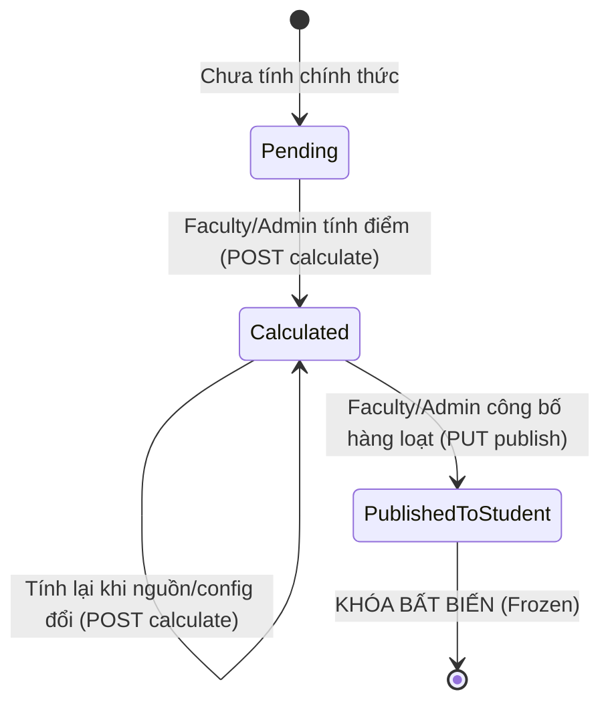

# Thesis score calculation & publication API contract — SCRUM-110

Trạng thái: **CP3 đã triển khai migration/lịch sử, POST calculate, ba GET quản trị, resolver động, stale/provenance và guards nguồn điểm; PUT publish và GET sinh viên thuộc CP4, chưa map**. Ngày 02/11/2026. Nền tảng kế thừa: [báo cáo cuối kỳ SCRUM-102](ThesisManagementApiContract.md), [duyệt GVHD SCRUM-103](AdvisorEvaluationApprovalApiContract.md), [phân công GVPB SCRUM-104](ReviewerAssignmentApiContract.md), [chấm GVPB và điều kiện bảo vệ SCRUM-105](ReviewerEvaluationApiContract.md), [lưu chiểu SCRUM-106](FinalSubmissionApiContract.md), [cấu hình điểm đợt](AcademicPeriodsApiContract.md). [Thiết kế schema/transaction/handoff](ArchivalScoreWorkflowDesign.md) là phần bắt buộc của contract này; [bằng chứng CP3](ScoreCalculationVerification.md) ghi phạm vi đã kiểm tra. Plan local vẫn ngoài Git.

Phạm vi SCRUM-110:
- Văn phòng Khoa (Faculty) hoặc Admin thực hiện tính điểm tổng kết dự thảo cho đề tài (`POST /api/thesis/scores/calculate/{groupId}`) dựa trên cấu hình điểm Active động của đợt và các nguồn dữ liệu chấm đã hoàn tất.
- Văn phòng Khoa hoặc Admin thực hiện công bố kết quả chính thức cho danh sách nhóm được chọn trong cùng một đợt (`PUT /api/thesis/scores/publish`). Nguyên tắc nguyên tử (All-or-Nothing): tất cả các nhóm được chọn cùng thành công hoặc toàn bộ request bị rollback nếu có bất kỳ nhóm nào không hợp lệ, bị stale hoặc xung đột phiên bản.
- Gỡ bỏ hoàn toàn nhánh tự động tổng hợp điểm trong `SubmitCouncilScoreHandler`; SCRUM-110 là nơi **DUY NHẤT** ghi nhận và quản lý kết quả tổng hợp điểm KLTN.
- Sinh viên chỉ được tra cứu bảng điểm chính thức của nhóm mình (`GET /api/thesis/scores/my-group`) khi VÀ CHỈ KHI đồng thời: 1) Kết quả đã ở trạng thái `PublishedToStudent`; 2) Hồ sơ lưu chiểu của nhóm đã được Khoa xác nhận (`ArchiveConfirmed`).
- Sau khi công bố (`PublishedToStudent`), snapshot kết quả và toàn bộ dữ liệu chấm/biên bản liên quan bị KHÓA BẤT BIẾN (Frozen). Không cho phép tính lại, ghi đè hoặc chỉnh sửa điểm/biên bản Hội đồng.
- Cung cấp các API tra cứu quản trị: xem bảng điểm chi tiết, danh sách bảng điểm phân trang kèm bộ lọc (đợt, trạng thái, readiness, stale), và kiểm tra điều kiện sẵn sàng tính/công bố.

Không bao gồm: UI SCRUM-115, xuất báo cáo tổng hợp Excel/PDF phục vụ xét tốt nghiệp, gửi email thông báo kết quả, phản biện thứ hai hoặc quy trình thu hồi/công bố lại sau khi đã phát hành.

---

## 1. Quy ước HTTP và phân quyền

### 1.1. Quy ước chung
- Tất cả endpoint yêu cầu Bearer token.
- Envelope chuẩn `ApiResponse<T>`: `{ "success": true, "data": ..., "error": null }`. Khi có lỗi: `{ "success": false, "data": null, "error": { "code": "...", "message": "..." } }`.
- Thời gian định dạng ISO 8601 UTC (`yyyy-MM-ddTHH:mm:ss.fffZ`).
- Định danh GUID chuẩn RFC 4122, khác GUID rỗng.
- Concurrency version `expectedSummaryVersion` là số nguyên `uint` > 0 (`xmin` của `ScoreSummary`).
- Hai write endpoint (`POST calculate` và `PUT publish`) yêu cầu header `Idempotency-Key` định dạng UUID không rỗng ở **mọi môi trường**.
- Giới hạn số lượng nhóm trong một request công bố: Tối thiểu 1 nhóm, tối đa 100 nhóm/request.
- `/my-group` bắt buộc query `groupId` GUID khác rỗng; server kiểm tra Student Active + Confirmed membership đúng group và suy ra batch. Không tự chọn một nhóm khi SV có lịch sử nhiều đợt. Selector thiếu/sai/trùng: 400; không thuộc nhóm: 403.
- Các GET không nhận body/key; selector không thay thế quyền. JSON ghi reject field lạ/trùng tên sau case-fold, enum số/numeric string, UUID rỗng và version không phải integer đúng khoảng; quyền được kiểm tra ở endpoint và handler trước lookup riêng tư.
- Tính/công bố chỉ khi batch Open hoặc Closed; Draft/Archived chặn ý định ghi mới. Đọc theo quyền, kể cả snapshot Published, vẫn được khi Closed/Archived; không áp hạn nộp SV vào staff.

### 1.2. Ma trận phân quyền

| Chủ thể | POST calculate (Tính điểm) | PUT publish (Công bố điểm) | GET quản trị chi tiết/danh sách/readiness | GET bảng điểm sinh viên (/my-group) |
| --- | --- | --- | --- | --- |
| **Văn phòng Khoa (Faculty)** | Có (có permission `councils.score-summaries.manage`) | Có (có permission `councils.score-summaries.publish`) | Có (có permission `councils.score-summaries.read`) | Không (chỉ theo nhánh Student nếu có) |
| **Phòng Đào tạo (AcademicAffairs)** | Không | Không | Có (có permission `councils.score-summaries.read`) | Chỉ theo nhánh Student nếu có |
| **Admin toàn hệ thống** | Có (ghi actor Admin thật) | Có (ghi actor Admin thật) | Có | Không (chỉ theo nhánh Student nếu có) |
| **Sinh viên Confirmed của nhóm** | Không | Không | Không | **Có** (chỉ khi đã Published VÀ đã ArchiveConfirmed) |
| **Sinh viên chưa đủ điều kiện / Ngoài nhóm** | Không | Không | Không | **403 Forbidden** (hoặc thông báo chưa công bố) |
| **Thành viên Hội đồng / GVHD / GVPB** | Không | Không | Không tự có quyền quản trị | Không tự có quyền |

**Quy tắc kiểm soát truy cập và bảo vệ dữ liệu điểm:**
1. Quyền thực thi tính điểm và công bố thuộc về Văn phòng Khoa (`Faculty`) và Quản trị viên (`Admin`). Phòng Đào tạo (`AcademicAffairs`) chỉ có quyền đọc để giám sát, điều phối; không có quyền can thiệp tính toán hoặc công bố.
2. Sinh viên tuyệt đối không được xem điểm dự thảo (`Calculated`), điểm các thành viên Hội đồng chi tiết hoặc snapshot điểm trước khi có quyết định công bố chính thức.
3. Sinh viên chỉ được tra cứu điểm khi đồng thời thỏa mãn hai điều kiện:
   - Bảng điểm của nhóm đang ở trạng thái `PublishedToStudent`.
   - Nhóm đã hoàn thành nộp lưu chiểu: `FinalSubmission` có trạng thái `ArchiveConfirmed`.
4. Rà soát các kênh có thể làm rò rỉ điểm trước công bố:
   - Endpoint `CheckCouncilDiscrepancy`: authorization ở endpoint và handler; Faculty/PĐT có permission đọc hoặc Admin, hay người tham gia có vai trò giảng viên/Hội đồng hợp lệ và đúng Council. Không tin chỉ một row roster hoặc token đăng nhập. Nhánh Student không cấp quyền đọc private dù có permission không phù hợp; multi-role phải thực sự thỏa một nhánh được phép.
   - `finalScore` trong discrepancy chỉ trả summary nonlegacy Calculated/Published của SCRUM-110; phép tính Pending/legacy cũ không được trình bày như điểm đã xác minh.
   - Endpoint Góp ý sinh viên SCRUM-105: Chỉ trả về nội dung góp ý (`comment`), tuyệt đối không đính kèm điểm số hay quyết định thông qua.
   - DTO trả về cho sinh viên tại `/my-group` là một Allowlist DTO riêng biệt, chỉ chứa điểm tổng kết và các điểm thành phần được phép công khai; không chứa S3 object key, audit metadata, hay thông tin cá nhân của người chấm.

---

## 2. Quy tắc tính điểm động và Resolver nguồn dữ liệu

### 2.1. Nguồn cấu hình tính điểm
Hệ thống sử dụng cấu hình điểm của đợt KLTN từ module `AcademicPeriods` thông qua hai aggregate:
- `ScoreWeightConfig`: Cấu hình phiên bản có trạng thái `ConfigurationVersionStatus.Active` của đợt (`BatchId`).
- `ScoreComponentConfig`: Danh sách các thành phần điểm thành phần trong cấu hình Active.

### 2.2. Ánh xạ nguồn dữ liệu (Component Source Resolver)
Từng thành phần trong `ScoreComponentConfig` có thuộc tính `Source` (`ScoreComponentSource`) được phân giải như sau:
1. **`Advisor`**: Lấy điểm từ `AdvisorEvaluation` (SCRUM-103). Điều kiện: Phiếu đã hoàn tất, không phải legacy, khớp đúng phiên bản báo cáo được duyệt.
2. **`Reviewer`**: Lấy điểm từ `ReviewerEvaluation` (SCRUM-105). Điều kiện: Phiếu ở trạng thái `Submitted`, không phải legacy, khớp snapshot phân công.
3. **`CouncilChairman`**: Lấy điểm chấm từ `CouncilScore` của thành viên giữ chức danh Chủ tịch (`CouncilMemberRole.Chairman`).
4. **`CouncilSecretary`**: Lấy điểm chấm từ `CouncilScore` của thành viên giữ chức danh Thư ký (`CouncilMemberRole.Secretary`).
5. **`CouncilMember`**: Lấy điểm chấm từ `CouncilScore` của thành viên giữ chức danh Ủy viên (`CouncilMemberRole.Member`).
6. **`CouncilAverage`**: Lấy điểm trung bình cộng của các thành viên Hội đồng được chấm hợp lệ.
7. **`Custom`**: Chưa hỗ trợ nguồn tự định nghĩa; component được áp dụng và cần nguồn nhưng chưa có producer/resolver trả UnsupportedSource, theo hậu điều kiện dưới đây.

**Hậu điều kiện resolver (không được chọn First/FirstOrDefault để giải quyết mơ hồ):**

- Validate config owner trước, rồi lọc Always + nhánh Applicability của đúng reviewer assignment/council. Unsupported source chỉ cần resolve khi component được áp dụng và weight > 0 hoặc IsRequired; component không áp dụng được ghi trong resolution snapshot, không lấy điểm/gán 0.
- Advisor/Reviewer phải có đúng một nguồn workflow hợp lệ. Chủ tịch/Thư ký phải ánh xạ duy nhất theo roster và group; score đúng CouncilAssignment/CouncilMember, không lấy phiếu thuộc group/council khác.
- CouncilMember được resolve khi có đúng một Ủy viên độc lập được chấm (loại reviewer kiêm nhiệm khỏi tập được nhập điểm Hội đồng). Nhiều ứng viên, kể cả một trong số đó bị ignored, trả `ScoreSummary.AmbiguousSource`; không chọn người đầu tiên hoặc tự bình quân thành một component.
- Reviewer là Chủ tịch/Thư ký, GVHD tham gia Hội đồng nhóm mình, roster trùng người/role bắt buộc hoặc thiếu phiếu đã hoàn thành: context invalid. Reviewer kiêm Ủy viên không tạo nguồn CouncilScore thứ hai.
- CouncilAverage dùng các phiếu đã hoàn thành của đúng roster được chấm, loại reviewer kiêm nhiệm và các phiếu bị loại có kết luận hợp lệ **trước** khi tính trung bình bằng decimal. Không round trung gian; tập được công nhận rỗng thì không có average hợp lệ.
- Nếu component được áp dụng cùng dùng CouncilAverage và điểm role thuộc tập average, hoặc nhiều component cùng tính lại một nguồn/phiếu, trả `ScoreSummary.AmbiguousSource`. Không cộng trùng dưới các ComponentCode khác nhau. IsIgnored không được dùng để hợp thức hóa ánh xạ mơ hồ.
- Custom được áp dụng chưa có producer/resolver trả `ScoreSummary.UnsupportedSource`; thiếu, invalid hoặc nhiều config Active trả lỗi cấu hình, không fallback CalculateDefault. Quy tắc chi tiết và ví dụ có trong thiết kế chung.
- Completeness của ba nguồn Advisor/Reviewer/Council độc lập với việc nguồn đã hoàn thành rồi bị loại. Không tự dùng MinimumScore/RequiresApproval như luật đạt/rớt mới để từ chối tính/công bố điểm thấp; các cổng đi tiếp thuộc workflow trước.

### 2.3. Quy tắc áp dụng theo vai trò GVPB (Applicability)
Hệ thống kiểm tra GVPB của đề tài có đồng thời là thành viên trong Hội đồng chấm đề tài đó hay không (`isReviewerInCouncil`):
- **Nếu GVPB kiêm nhiệm Ủy viên trong Hội đồng (`ReviewerInCouncil`):**
  - Chỉ tính các thành phần có `Applicability` là `Always` hoặc `ReviewerInCouncil`.
  - GVPB lấy điểm từ phiếu phản biện trước bảo vệ; bị khóa nhập điểm Hội đồng thứ hai.
  - Bộ hệ số mặc định chuẩn: `(2 * HD + 2 * PB + 1 * CT + 1 * TK) / 6` (Tổng hệ số = 6).
- **Nếu GVPB không thuộc Hội đồng (`ReviewerOutsideCouncil`):**
  - Chỉ tính các thành phần có `Applicability` là `Always` hoặc `ReviewerOutsideCouncil`.
  - Hội đồng có thêm điểm của Ủy viên độc lập.
  - Bộ hệ số mặc định chuẩn: `(2 * HD + 2 * PB + 1 * CT + 1 * TK + 1 * UV) / 7` (Tổng hệ số = 7).

### 2.4. Xử lý điểm không được công nhận (`IsIgnoredInCalculation = true`)
- Khi Thư ký/Chủ tịch Hội đồng đánh dấu một đầu điểm không được công nhận trong biên bản Hội đồng (`IsIgnoredInCalculation = true` kèm `ExclusionReason`):
  - Đầu điểm này bị **LOẠI BỎ CẢ ĐIỂM VÀ TRỌNG SỐ** khỏi cả tử số và mẫu số của phép tính.
  - Vẫn lưu vết thành phần này trong danh sách `ScoreSummaryComponent` với `IsIgnoredInCalculation = true` để phục vụ thanh tra, kiểm toán.
  - Nếu tổng trọng số hợp lệ còn lại sau khi loại trừ `<= 0`: Hệ thống từ chối tính toán và báo lỗi không có kết quả hợp lệ (không chia cho 0, không tự động gán điểm 0).

### 2.5. Công thức toán học và chuẩn hóa làm tròn
- Phép tính được thực hiện hoàn toàn bằng kiểu dữ liệu số học `decimal`:
  $$\text{FinalScoreRaw} = \frac{\sum (Score_i \times Weight_i)}{\sum Weight_i}$$
  (với các thành phần $i$ hợp lệ và không bị loại trừ).
- Phương thức `Percentage`: Chuẩn hóa tỷ lệ theo tổng phần trăm các thành phần còn lại được công nhận.
- **Quy tắc làm tròn:**
  - Không làm tròn các giá trị tích hoặc tổng trung gian.
  - Chỉ làm tròn kết quả điểm tổng kết cuối cùng về 2 chữ số thập phân bằng `AwayFromZero` theo quyết định thiết kế của hai task, không tuyên bố đây là quy chế chung của trường:
    `decimal.Round(finalScoreRaw, 2, MidpointRounding.AwayFromZero)`.

---

## 3. Vòng đời Bảng điểm và Cơ chế Chống Dữ liệu Cũ (Lifecycle & Anti-Stale)



### 3.1. Các trạng thái
- **`Pending`**: Nhóm chưa được tính điểm chính thức hoặc chỉ có bản ghi tạm thời từ giai đoạn trước.
- **`Calculated`**: Điểm đã được tính toán thành công ở trạng thái Dự thảo. Hệ thống lưu snapshot toàn bộ cấu hình, phiên bản cấu hình, chi tiết từng thành phần điểm và lịch sử tính toán.
- **`PublishedToStudent`**: Bảng điểm đã được công bố chính thức. Đây là trạng thái **CUỐI CÙNG VÀ BẤT BIẾN**. Không cho phép tính lại, không cho phép ghi đè. Toàn bộ các writer của CouncilScore và CouncilMinute bị khóa đối với nhóm này.

### 3.2. Cơ chế phát hiện Stale (Dữ liệu bị lỗi thời)
Một bản ghi `ScoreSummary` ở trạng thái `Calculated` sẽ bị coi là **Stale** nếu phát hiện bất kỳ sự thay đổi nào sau thời điểm tính:
1. Cấu hình Active ID/version/contents không còn khớp snapshot (hoặc không còn đúng một config Active hợp lệ).
2. Dữ liệu điểm thành phần bị thay đổi (điểm GVHD, điểm GVPB, hoặc điểm thành viên Hội đồng được nhập lại hoặc sửa đổi).
3. Biên bản Hội đồng bị mở khóa (`CouncilMinute.LockStatus != Locked`).
4. Hồ sơ lưu chiểu bị thay đổi phiên bản hoặc mất trạng thái `ArchiveConfirmed`.
5. Cờ loại trừ, kết luận hoặc source/roster/binding liên quan thay đổi, kể cả bỏ cờ ignored; không chỉ kiểm tra đổi từ false sang true.

Mỗi calculation revision lưu input snapshot và SHA256 canonical bao gồm IDs/version của phiếu, assignment/roster, minute, archive package/manifest/hai review và config ID/version/contents. Publish dựng lại proof dưới khóa và so fingerprint, không chỉ so điểm số, timestamp hoặc ConfigVersionNo. Batch status Open → Closed hợp lệ, deadline SV, tài khoản của người từng chấm nghỉ và cấu hình đổi **sau Published** không tự thu hồi snapshot đã công bố.

Khi thực hiện thao tác **Công bố (`PUT publish`)**, hệ thống bắt buộc kiểm tra lại (revalidate) toàn bộ các điều kiện trên. Nếu phát hiện bảng điểm bị Stale, hệ thống từ chối công bố (trả về `409 Conflict`), yêu cầu người quản trị thực hiện tính lại điểm (`POST calculate`) để cập nhật snapshot mới nhất trước khi công bố.

---

## 4. Thứ tự Khóa Toàn cục và Chống Xung đột Đồng thời (Global Lock Order & Concurrency)

Áp dụng [protocol đầy đủ trong thiết kế chung](ArchivalScoreWorkflowDesign.md): transaction/key lock → **tất cả** group roots tăng dần FOR UPDATE và dependent group facts → topics → batches → advisor approval facts → account/grants cần cho thao tác hiện tại → archival rows → reviewer assignment/evaluation → council/assignment/roster/minute/scores → config Active → summaries. Mọi tập IDs cùng loại được sort. Owner calls không được lấy lại khóa ở pha trước sau khi đã đi qua pha sau.

- Owner Lock methods tham gia ambient shared transaction, không nhận coordinator/DbTransaction qua contract. GET/readiness thông thường không khóa và không cấp proof để ghi.
- Bổ sung group root protocol vào các writer chấm/mở khóa/loại điểm hiện hữu; chốt guard trước save trong cùng transaction, giữ tới receipt/audit commit. Chỉ kiểm tra Published ở preflight rồi SaveChanges riêng không đủ chống publish-vs-rescore.
- CP3 dùng chung `ScoreSummaryInputLoader.LockManyAsync` cho pipeline khóa: hoàn thành mỗi pha trên toàn bộ nhóm đã sort trước khi sang pha tiếp. Calculate gọi một nhóm; CP4 dùng lại để công bố selection, không gọi trọn chuỗi từng nhóm rồi mới lấy root tiếp. Host coordinator chỉ ghi DefenseCouncil, bốn module còn lại là reader cùng backend/transaction.
- Config Active dùng FOR SHARE, reselect bằng statement mới khi publisher thắng/retire row trong lúc chờ; tối đa ba lượt, hết lượt trả conflict và Abort. Không lấy snapshot cũ đã retired làm proof.

**Bảo vệ các Writer hiện hữu sau khi điểm đã công bố:**
- Trong `SubmitCouncilScoreHandler`: dưới group root lock kiểm tra Published ở trạng thái hiện tại rồi mới cho ghi; đã Published trả `CouncilErrors.ScoresAlreadyPublished`. Nếu thêm draft writer sau này cũng phải dùng protocol này; baseline chưa có `SaveDraftCouncilScoreHandler`.
- Gỡ bỏ hoàn toàn nhánh tự động tạo/lưu `ScoreSummary` trong `SubmitCouncilScoreHandler` (loại bỏ việc gọi `CalculateDefault` ngầm).
- Trong các thao tác cập nhật/mở khóa `CouncilMinute`: Từ chối nếu điểm của đề tài đã ở trạng thái `PublishedToStudent`.

---

## 5. Đặc tả API Endpoints

### 5.1. `POST /api/thesis/scores/calculate/{groupId}`
Tính hoặc tính lại điểm tổng kết dự thảo cho một nhóm đề tài.

**Đã triển khai CP3.** JSON tối đa 16 KiB; authorize bằng account/role/permission live trước parse body và trong handler, recheck sau khi chờ key và giữ authority guards trong transaction mới. Reject field lạ/trùng case-fold, số dạng chuỗi/phân số/ngoài khoảng, query và actor/score/weight do client gửi. Có thể omit cả hai kỳ vọng; summary đã tồn tại vẫn bắt buộc đúng xmin khi thực hiện ý định mới.

Tính cần nguồn Advisor/Reviewer hoàn tất và khớp đúng InitialFinal report/file/checksum, không dùng trạng thái nhóm ReadyForDefense/ReadyForReviewerAssignment thay completeness. CouncilScore phải thuộc đúng assignment/roster, có chi tiết tiêu chí và tổng phù hợp; current minute Locked đúng actor/time/xmin, không có timestamp tương lai so với TimeProvider dưới guards. ArchiveProof lấy thật từ owner CP2. Unsupported Custom, nhiều UV hoặc source overlap trả lỗi 409; không chọn First hoặc fallback/gán 0.

Mỗi lần tính thành công tạo revision bất biến, giữ toàn bộ lịch sử/components, source/config snapshots và fingerprint canonical; chỉ round final hai số AwayFromZero. Config/nguồn không đổi vẫn có thể chủ động tạo revision mới bằng key mới và xmin hiện tại. Retry đúng key/actor/ý định trả DTO/xmin gốc sau kiểm tra quyền, kể cả đợt đã Archived hoặc state đã đổi; không audit/revision lần hai. Cùng key khác ý định trả IdempotencyConflict.

**Headers:**
- `Authorization: Bearer <token>`
- `Content-Type: application/json`
- `Idempotency-Key: 22222222-2222-2222-2222-222222222201`

**Request Body:**
```json
{
  "expectedSummaryVersion": null,
  "expectedActiveConfigVersion": 1
}
```

| Trường | Kiểu | Bắt buộc | Quy tắc |
| --- | --- | --- | --- |
| `expectedSummaryVersion` | `uint?` | Có khi aggregate tồn tại | Omit/null chỉ khi chưa có summary row; nếu đã có Pending/Calculated/legacy thì phải truyền xmin hiện tại từ GET. Legacy được tính mới từ nguồn hợp lệ, không dùng lại finalScore/snapshot cũ làm nguồn hoặc tự phát hành. Published chặn mọi ý định tính mới. |
| `expectedActiveConfigVersion` | `int?` | Không | Khi có phải là số nguyên dương khớp config Active đã khóa; omit/null là không đặt kỳ vọng version. Server vẫn kiểm tra đúng một Active config và snapshot ID/version/contents. |

**Tiền điều kiện:**
1. Đợt KLTN đang ở trạng thái `Open` hoặc `Closed` (chặn khi `Draft` hoặc `Archived`).
2. Đợt có cấu hình điểm ở trạng thái `Active`.
3. Defense proof Locked hợp lệ: đúng group/batch/assignment, minute/version và actor/time theo owner contract; không chỉ đọc flag LockStatus.
4. Đầy đủ tất cả các đầu điểm thành phần bắt buộc theo cấu hình đợt.
5. Owner ArchiveProof trả Succeeded với package/manifest/hai file/hai review hợp lệ theo contract 106; status ArchiveConfirmed thiếu bằng chứng không đạt.

**Response (200 OK):**
```json
{
  "success": true,
  "data": {
    "summaryId": "4a5b6c7d-8e9f-0a1b-2c3d-4e5f6a7b8c9d",
    "groupId": "7c9e6679-7425-40de-944b-e07fc1f90ae7",
    "batchId": "9b8a7c6d-5e4f-3a2b-1c0d-9e8f7a6b5c4d",
    "status": "Calculated",
    "finalScore": 8.43,
    "totalWeight": 7.0,
    "calculationFormula": "(2*HD + 2*PB + 1*CT + 1*TK + 1*UV) / 7",
    "configVersionNo": 1,
    "calculatedAt": "2026-11-02T05:00:00Z",
    "calculatedBy": "1f2e3d4c-5b6a-7f8e-9d0c-1b2a3f4e5d6c",
    "isStale": false,
    "summaryVersion": 201,
    "components": [
      {
        "componentCode": "ADVISOR",
        "componentName": "Điểm Người hướng dẫn",
        "source": "Advisor",
        "score": 8.5,
        "weight": 2.0,
        "isIgnoredInCalculation": false,
        "exclusionReason": null
      },
      {
        "componentCode": "REVIEWER",
        "componentName": "Điểm Người phản biện",
        "source": "Reviewer",
        "score": 8.0,
        "weight": 2.0,
        "isIgnoredInCalculation": false,
        "exclusionReason": null
      },
      {
        "componentCode": "COUNCIL_CHAIRMAN",
        "componentName": "Chủ tịch Hội đồng",
        "source": "CouncilChairman",
        "score": 9.0,
        "weight": 1.0,
        "isIgnoredInCalculation": false,
        "exclusionReason": null
      },
      {
        "componentCode": "COUNCIL_SECRETARY",
        "componentName": "Thư ký Hội đồng",
        "source": "CouncilSecretary",
        "score": 8.5,
        "weight": 1.0,
        "isIgnoredInCalculation": false,
        "exclusionReason": null
      },
      {
        "componentCode": "COUNCIL_MEMBER",
        "componentName": "Ủy viên Hội đồng",
        "source": "CouncilMember",
        "score": 8.5,
        "weight": 1.0,
        "isIgnoredInCalculation": false,
        "exclusionReason": null
      }
    ]
  },
  "error": null
}
```

---

### 5.2. `PUT /api/thesis/scores/publish`
Công bố kết quả điểm chính thức cho danh sách nhóm được chọn trong cùng một đợt.

**Thiết kế CP4, chưa map ở CP3.** Schema published pointer/actor/time, receipt operation Publish và các guards đã được tạo ở CP3; không coi dữ liệu Published dựng trong test là bằng chứng endpoint này đã chạy.

**Headers:**
- `Authorization: Bearer <token>`
- `Content-Type: application/json`
- `Idempotency-Key: 22222222-2222-2222-2222-222222222202`

**Request Body:**
```json
{
  "batchId": "9b8a7c6d-5e4f-3a2b-1c0d-9e8f7a6b5c4d",
  "selections": [
    {
      "groupId": "7c9e6679-7425-40de-944b-e07fc1f90ae7",
      "expectedSummaryVersion": 201
    },
    {
      "groupId": "8d0f7780-8536-41ef-a55c-f18fd20a1bf8",
      "expectedSummaryVersion": 154
    }
  ]
}
```

| Trường | Kiểu | Bắt buộc | Quy tắc |
| --- | --- | --- | --- |
| `batchId` | `Guid` | Có | Định danh đợt KLTN. Tất cả nhóm được chọn phải cùng thuộc đợt này. |
| `selections` | `array` | Có | Danh sách nhóm được chọn. Tối thiểu 1, tối đa 100 phần tử; không chứa `groupId` trùng lặp. |
| `selections[].groupId` | `Guid` | Có | Định danh nhóm đề tài cần công bố. |
| `selections[].expectedSummaryVersion` | `uint` | Có | Version `xmin` của bản ghi `ScoreSummary` tương ứng. |

**Quy trình xử lý nguyên tử (All-or-Nothing Transaction):**
1. Authorize và chuẩn hóa ý định/selection; duplicate groupId bị 400, không tự deduplicate.
2. Mở transaction duy nhất, lấy advisory transaction key lock, kiểm tra lại quyền sau khi chờ rồi kiểm tra receipt/replay.
3. Lấy **tất cả** group roots tăng dần trước các owner facts/config/summary theo protocol chung. Recheck Published guard và input proof trong transaction duy nhất, không gọi GET ngoài transaction làm proof.
4. Revalidate từng nhóm:
   - `ScoreSummary.Status` phải là `Calculated`.
   - `ScoreSummary.Version` phải khớp `expectedSummaryVersion`.
   - Bảng điểm không bị Stale: Cấu hình Active không đổi, không có điểm nào bị sửa sau tính, hồ sơ lưu chiểu vẫn là `ArchiveConfirmed`, biên bản Hội đồng vẫn `Locked`.
5. **Xử lý lỗi nguyên tử:** Nếu BẤT KỲ nhóm nào vi phạm (ví dụ: bị stale, version cũ, chưa archive, hoặc khác đợt) -> **ROLLBACK TOÀN BỘ TRANSACTION**, trả về `409 Conflict` kèm danh sách chi tiết các nhóm không hợp lệ. Tuyệt đối không công bố một phần danh sách.
6. Khi tất cả các nhóm hợp lệ: Cập nhật `Status = PublishedToStudent`, `PublishedAt = UtcNow`, `PublishedBy = ActorId` cho toàn bộ nhóm, ghi nhận AuditLog và lưu IdempotencyReceipt trước khi commit.

**Response (200 OK):**
```json
{
  "success": true,
  "data": {
    "batchId": "9b8a7c6d-5e4f-3a2b-1c0d-9e8f7a6b5c4d",
    "publishedCount": 2,
    "publishedAt": "2026-11-02T05:30:00Z",
    "publishedGroupIds": [
      "7c9e6679-7425-40de-944b-e07fc1f90ae7",
      "8d0f7780-8536-41ef-a55c-f18fd20a1bf8"
    ]
  },
  "error": null
}
```

---

### 5.3. `GET /api/thesis/scores/my-group?groupId={groupId}`
Tra cứu bảng điểm chính thức của nhóm sinh viên đang đăng nhập.

**Thiết kế CP4, chưa map ở CP3.** Ba GET CP3 là private, không mở nhánh Student để thay endpoint này.

**Quyền truy cập:** Sinh viên có tài khoản Active và là thành viên `Confirmed` của một nhóm đề tài.

Query groupId bắt buộc, kiểm tra membership của đúng group ở đúng đợt kể cả Closed/Archived; không tự lấy nhóm ở đợt mới nhất. Thiếu/sai/trùng selector 400; ngoài nhóm 403 trước khi trả thông tin publication. Admin/Faculty/PĐT chỉ vào endpoint này qua nhánh Student thực sự hợp lệ.

**Quy tắc hiển thị điểm (Sinh viên chỉ xem khi đã công bố VÀ đã hoàn thành lưu chiểu):**
- Nếu bảng điểm chưa ở trạng thái `PublishedToStudent`: Trả về lỗi `403 Forbidden` (Code: `ScoreSummary.NotYetPublished`, Message: "Điểm của nhóm chưa được công bố chính thức").
- Nếu bảng điểm đã `PublishedToStudent` nhưng hồ sơ lưu chiểu chưa `ArchiveConfirmed`: Trả về lỗi `403 Forbidden` (Code: `ScoreSummary.ArchivalNotConfirmed`, Message: "Nhóm chưa hoàn thành nộp lưu chiểu nên chưa thể tra cứu điểm chính thức").
- Khi thỏa mãn cả hai điều kiện: Trả về **Allowlist DTO** chính thức:

Nguồn response là PublishedRevisionId bất biến cùng archive proof đã gắn vào revision đó, không lấy điểm/roster/config Active hiện tại để dựng lại. `components` chỉ gồm contribution được công nhận đã tính vào kết quả; contribution ignored và nhận xét/lý do nội bộ không được ghép vào DTO này.

```json
{
  "success": true,
  "data": {
    "groupId": "7c9e6679-7425-40de-944b-e07fc1f90ae7",
    "topicTitle": "Nghiên cứu ứng dụng thị giác máy tính...",
    "status": "PublishedToStudent",
    "publishedAt": "2026-11-02T05:30:00Z",
    "finalScore": 8.43,
    "calculationFormula": "(2*HD + 2*PB + 1*CT + 1*TK + 1*UV) / 7",
    "components": [
      {
        "componentName": "Điểm Người hướng dẫn",
        "score": 8.5,
        "weight": 2.0
      },
      {
        "componentName": "Điểm Người phản biện",
        "score": 8.0,
        "weight": 2.0
      },
      {
        "componentName": "Chủ tịch Hội đồng",
        "score": 9.0,
        "weight": 1.0
      },
      {
        "componentName": "Thư ký Hội đồng",
        "score": 8.5,
        "weight": 1.0
      },
      {
        "componentName": "Ủy viên Hội đồng",
        "score": 8.5,
        "weight": 1.0
      }
    ]
  },
  "error": null
}
```

---

### 5.4. `GET /api/thesis/scores/group/{groupId}`
Tra cứu chi tiết bảng điểm phục vụ quản trị (Faculty, AcademicAffairs, Admin). Trả về đầy đủ snapshot, nguồn điểm, cờ stale, lịch sử tính toán và metadata kiểm toán.

Faculty/PĐT cần role + `councils.score-summaries.read`; Admin theo ma trận. Không trả audit payload thô hoặc object key/URL; audit metadata ở đây là calculatedBy/At, publishedBy/At và revision IDs. Summary chưa có: 404; chưa tính nhưng có row Pending/legacy: trả status/version/legacy và không coi điểm cũ là kết quả chính thức. DTO chi tiết giữ shape calculation response, thêm activeRevisionId/publishedRevisionId, source references và revisions theo thiết kế chung.

CP3 trả `ScoreSummaryDto` gồm components của đúng active revision (legacy chỉ components revision null), revisions giảm dần và các cờ version/legacy/stale. Mỗi revision có IDs/version, raw/final/weight, actor/time, fingerprint và đủ SourceSnapshot/ConfigSnapshot; snapshots là chuỗi JSON để quản trị rà soát, SourceReferences của component là chuỗi JSON IDs nguồn. Snapshot nguồn có prefix `ThesisScoreInputs:v1`, danh tính group/topic/batch/GVHD và tiêu đề Việt/Anh, tiếp theo các source/proof arrays theo code resolver. Fingerprint gắn policy `ThesisScore:v1`, AwayFromZero/2 và hai snapshot canonical; không hash thời điểm gọi calculate. Không ghép components nhiều revision thành một phép tính. GET không tạo row/ghi stale; đổi nguồn/config/tiêu đề trước publish làm isStale=true, giữ kết quả cũ để rà soát. Published đọc snapshot cũ, không tự stale vì live config/tiêu đề đổi.

---

### 5.5. `GET /api/thesis/scores`
Danh sách bảng điểm đợt KLTN có phân trang phục vụ quản lý và rà soát trước công bố.

**Query Parameters:**
- `batchId`: GUID (bắt buộc)
- `status`: String (tùy chọn: `Pending`, `Calculated`, `PublishedToStudent`)
- `isStale`: Boolean (tùy chọn: `true` / `false`)
- `isReadyForPublication`: Boolean (tùy chọn)
- `pageNumber`: Int >= 1 (mặc định 1)
- `pageSize`: Int từ 1 đến 100 (mặc định 20)

Faculty/PĐT + read hoặc Admin; không có Student/lecturer ownership override. Response `ApiResponse<PagedResult<ScoreSummaryListItemDto>>`; danh sách bắt đầu từ group của batch để bao gồm nhóm chưa có summary, status Pending là giá trị đọc suy ra (không tự tạo row). Item: groupId, topicTitle, summaryId/version nullable, status, finalScore nullable nếu chưa tính, isLegacy, isStale, isReadyForCalculation/Publication, calculatedAt/publishedAt. Filter trước count/page, sort groupId tăng dần, không N+1; không trả private snapshot/actor/file metadata trong từng item.

---

### 5.6. `GET /api/thesis/scores/readiness/{groupId}`
Kiểm tra các điều kiện sẵn sàng để tính hoặc công bố điểm cho một nhóm đề tài.

Chỉ management read theo ma trận; GET không mutate, không giữ khóa và không cấp quyền cho POST/PUT. `blockingReasons` dùng error code chuẩn theo thiết kế chung; `Calculated` nonlegacy, không stale và mọi guard hợp lệ thì isReadyForPublication=true.

Readiness phản ánh điều kiện của bước công bố dự kiến, không có nghĩa CP3 đã thực hiện công bố. Flags điểm/Locked/archive/config được đọc riêng; Stale/Legacy có thể chặn publication dù vẫn cho phép calculate mới. Danh sách bắt đầu từ nhóm của đợt, lấy context, grade facts, archive proofs và histories theo lô trước filter/count/page; không query từng nhóm hoặc tạo Pending row.

**Response (200 OK):**
```json
{
  "success": true,
  "data": {
    "groupId": "7c9e6679-7425-40de-944b-e07fc1f90ae7",
    "isReadyForCalculation": true,
    "isReadyForPublication": true,
    "isCouncilMinuteLocked": true,
    "hasAllRequiredScores": true,
    "isArchiveConfirmed": true,
    "hasActiveScoreConfig": true,
    "currentSummaryStatus": "Calculated",
    "isStale": false,
    "blockingReasons": []
  },
  "error": null
}
```

---

## 6. Ma trận Tiêu chí Nghiệm thu (Acceptance Criteria SP-01 đến SP-18)

| Mã tiêu chí | Tên tiêu chí & Mục tiêu kiểm thử | Quy tắc & Kết quả mong đợi |
| --- | --- | --- |
| **SP-01** | Quyền tính và công bố điểm | Chỉ Faculty/Admin có quyền tính và công bố. AcademicAffairs chỉ đọc. Sinh viên và các vai trò khác bị từ chối 403. Admin audit đúng actor thực tế. |
| **SP-02** | Đủ nguồn chấm và proof hợp lệ | AdvisorEvaluation hoàn tất, ReviewerEvaluation Submitted, CouncilScores đầy đủ theo roster, defense proof Locked và ArchiveProof Succeeded phải đúng binding/nonlegacy/provenance. Status hoặc boolean legacy không thay proof; thiếu bất kỳ điều kiện nào thì từ chối. |
| **SP-03** | Hai công thức chuẩn mặc định | Kiểm chứng tính chính xác: Trường hợp GVPB kiêm nhiệm tính mẫu 6 (ra 47/6 ≈ 7.83); trường hợp GVPB ngoài Hội đồng tính mẫu 7 (ra 53/7 ≈ 7.57) với bộ dữ liệu mẫu trong Requirements. |
| **SP-04** | Cấu hình động & Applicability | Hệ thống phân giải chính xác theo `ScoreComponentSource` và `ScoreComponentApplicability` (Always, ReviewerInCouncil, ReviewerOutsideCouncil), không match cứng theo ComponentCode. |
| **SP-05** | Loại điểm & Chuẩn hóa làm tròn | Điểm có `IsIgnoredInCalculation = true` bị loại cả điểm và trọng số khỏi tử số và mẫu số. Tổng trọng số <= 0 bị từ chối. Làm tròn AwayFromZero 2 chữ số thập phân ở kết quả cuối cùng; không làm tròn trung gian. |
| **SP-06** | GVPB/nguồn mơ hồ không tính trùng | Reviewer kiêm Ủy viên không có CouncilScore thứ hai; nhiều UV cho CouncilMember, duplicate source/phiếu hoặc CouncilAverage chồng với role trả lỗi, không First/AVG tùy ý. |
| **SP-07** | Cấu hình Active thiếu/mâu thuẫn | Nếu đợt không có cấu hình Active, hoặc cấu hình mâu thuẫn (như Custom thiếu resolver) -> Fail closed: từ chối tính, không fallback công thức cứng. |
| **SP-08** | Tính lại trước công bố lưu lịch sử | Cho phép tính lại khi ở `Calculated` để cập nhật snapshot; lưu lại lịch sử tính toán (`ScoreSummaryRevision`). Bảng điểm cũ của legacy không được tự động phát hành. |
| **SP-09** | Chống Stale khi công bố | So current proof/fingerprint với revision dưới khóa: ID/version/config contents, binding/roster/phiếu/ignored (cả bật và tắt)/minute/archive thay đổi đều 409. Sau Published, thay Active config không đổi snapshot hoặc làm mất quyền đọc hợp lệ. |
| **SP-10** | Công bố nhóm chọn lọc nguyên tử (All-or-Nothing) | Request công bố danh sách nhóm trong cùng đợt (tối đa 100 nhóm). Nếu có 1 nhóm bị lỗi hoặc stale -> Rollback toàn bộ giao dịch, không công bố một phần. |
| **SP-11** | Idempotency & Chống trùng lặp | Header `Idempotency-Key` UUID ở mọi môi trường. Chuẩn hóa thứ tự nhóm khi lưu fingerprint. Retry đúng key trả kết quả gốc; dùng lại key cho body khác trả 409. Không tạo audit đôi. |
| **SP-12** | Thứ tự khóa toàn cục chống Deadlock | Protocol đầy đủ trong thiết kế chung; khóa tất cả group roots trước owner facts; source writers cũng giữ root/Published guard tới commit. Test publish vs rescore/unlock, config publisher hai thứ tự và fresh bounded reselect. |
| **SP-13** | Rollback khi lưu thất bại | Nếu xảy ra lỗi DB, hủy token hoặc lỗi outbox trong lúc publish -> Toàn bộ thay đổi rollback; không có nhóm nào bị chuyển trạng thái nửa vời. |
| **SP-14** | Sinh viên xem bảng điểm chính thức | groupId selector bắt buộc, SV có nhóm ở hai đợt vẫn chọn đúng bảng điểm, không fallback nhóm mới nhất; check Confirmed/Published/bound archive proof, IDOR/selector lỗi/multi-role đều được kiểm tra. |
| **SP-15** | Bảo mật không rò rỉ điểm qua kênh khác | Khóa endpoint `CheckCouncilDiscrepancy` không cho sinh viên truy cập; Góp ý sinh viên SCRUM-105 không chứa điểm; DTO sinh viên dùng allowlist nghiêm ngặt. |
| **SP-16** | Snapshot bất biến sau công bố | Sau khi công bố, điểm tổng kết và các thành phần được lưu cố định. Sinh viên vẫn đọc được snapshot này khi đợt chuyển sang `Closed` hoặc `Archived`. |
| **SP-17** | Đặc tả OpenAPI chính xác | Toàn bộ schema DTO, query parameters, header Idempotency-Key, enum và mã lỗi HTTP được mô tả đầy đủ, chuẩn OpenAPI. |
| **SP-18** | Kiểm thử tích hợp E2E toàn diện | Kestrel/PG/MinIO: nộp v1 rồi nộp lại Submitted v2 -> GVHD -> Khoa -> calculate -> selected publish -> Student snapshot. Nếu Locked upstream dùng seed vì chưa có API khóa, báo cáo nêu rõ, không tuyên bố đã có E2E qua API khóa biên bản. |

