# KIẾN TRÚC HỆ THỐNG UGTM (UNDERGRADUATE GRADUATION THESIS MANAGEMENT)
## Tham chiếu mô hình: Modular Monolith with DDD (.NET 10)

> Tài liệu này mô tả chi tiết thiết kế kiến trúc của hệ thống **UGTM** dựa trên phương pháp luận **Modular Monolith kết hợp Domain-Driven Design (DDD)** và chuẩn hóa biểu đồ theo **Mô hình C4 (Context, Container, Component, Code)** cùng các biểu đồ tương tác CQRS, Event-Driven Integration, Database Schemas và Security Authentication Flow.

---

## MỤC LỤC

1. [Tổng quan Kiến trúc Cốt lõi](#1-tổng-quan-kiến-trúc-cốt-lõi)
2. [Mô hình Khái niệm Miền (Domain Conceptual Model)](#2-mô-hình-khái-niệm-miền-domain-conceptual-model)
3. [Mô hình C4 (C4 Architecture Model)](#3-mô-hình-c4-c4-architecture-model)
   - [3.1 C1 — System Context Diagram](#31-c1--system-context-diagram)
   - [3.2 C2 — Container Diagram](#32-c2--container-diagram)
   - [3.3 C3 — Component Diagram (High-Level View)](#33-c3--component-diagram-high-level-view)
   - [3.4 C3 — Component Diagram (Module Deep-Dive: Clean Architecture 4 Layer)](#34-c3--component-diagram-module-deep-dive-clean-architecture-4-layer)
   - [3.5 C4 — Code Diagram (Thesis Aggregate Model)](#35-c4--code-diagram-thesis-aggregate-model)
4. [Mô hình Xử lý Yêu cầu qua CQRS](#4-mô-hình-xử-lý-yêu-cầu-qua-cqrs)
   - [4.1 Phân tách Write Model & Read Model (CQRS Architecture)](#41-phân-tách-write-model--read-model-cqrs-architecture)
   - [4.2 Luồng xử lý Command & Query (Sequence Flow)](#42-luồng-xử-lý-command--query-sequence-flow)
   - [4.3 Cross-Cutting Concerns: Pipeline Behaviors / Decorator Pattern](#43-cross-cutting-concerns-pipeline-behaviors--decorator-pattern)
5. [Tích hợp liên Module (Inter-Module Integration via Outbox & Event Bus)](#5-tích-hợp-liên-module-inter-module-integration-via-outbox--event-bus)
6. [Bảo mật & Phân quyền (Security & Authentication Flow)](#6-bảo-mật--phân-quyền-security--authentication-flow)
7. [Kiến trúc Dữ liệu & Phân tách Schema (Multi-Schema Database Architecture)](#7-kiến-trúc-dữ-liệu--phân-tách-schema-multi-schema-database-architecture)
8. [Biểu đồ Luồng Nghiệp vụ 7 Giai đoạn & 2 Cổng Kiểm soát (Gatekeeper Workflow)](#8-biểu-đồ-luồng-nghiệp-vụ-7-giai-đoạn--2-cổng-kiểm-soát-gatekeeper-workflow)

---

> 📂 **Thư mục Mã nguồn PlantUML (`docs/PlantUML/`)**:
> - [Conceptual_Model.puml](PlantUML/Conceptual_Model.puml)
> - [C1_System_Context.puml](PlantUML/C1_System_Context.puml)
> - [C2_Containers.puml](PlantUML/C2_Containers.puml)
> - [C3_Components_HighLevel.puml](PlantUML/C3_Components_HighLevel.puml)
> - [C3_Components_ModuleDeepDive.puml](PlantUML/C3_Components_ModuleDeepDive.puml)
> - [C4_Code_Aggregate.puml](PlantUML/C4_Code_Aggregate.puml)
> - [CQRS_Architecture.puml](PlantUML/CQRS_Architecture.puml)
> - [CQRS_Sequence.puml](PlantUML/CQRS_Sequence.puml)
> - [Pipeline_Decorators.puml](PlantUML/Pipeline_Decorators.puml)
> - [EventBus_Outbox_Integration.puml](PlantUML/EventBus_Outbox_Integration.puml)
> - [Security_Authentication_Flow.puml](PlantUML/Security_Authentication_Flow.puml)
> - [MultiSchema_Database.puml](PlantUML/MultiSchema_Database.puml)
> - [Gatekeeper_Workflow.puml](PlantUML/Gatekeeper_Workflow.puml)

---

## 1. Tổng quan Kiến trúc Cốt lõi

Hệ thống UGTM áp dụng kiến trúc **Modular Monolith**:
- **Tính đóng gói (Encapsulation)**: Mỗi module nghiệp vụ độc lập đại diện cho một **Bounded Context**, sở hữu riêng dữ liệu, logic ứng dụng và quy tắc miền.
- **Ranh giới nghiêm ngặt (Strict Boundaries)**: Các module **tuyệt đối không** tham chiếu trực tiếp tầng `Domain`, `Application` hay `Infrastructure` của nhau. Mọi giao tiếp đồng bộ hoặc bất đồng bộ chỉ thông qua tầng `Contracts` (DTOs, Integration Events). Ranh giới này được kiểm soát tự động bởi bộ kiểm thử `backend/tests/Architecture.Tests`.
- **Tách bạch Read/Write (CQRS)**: Tách riêng luồng ghi (`Commands` xử lý qua Domain Model và Transaction) và luồng đọc (`Queries` trả về DTOs tối ưu hiệu năng).
- **Tính tự chủ dữ liệu (Logical Data Isolation)**: Tất cả module dùng chung một Database SQL Server nhưng phân tách thành các schema độc lập (`identity`, `academic`, `topics`, `thesis`, `councils`,...), không dùng Foreign Key vật lý liên schema.

---

## 2. Mô hình Khái niệm Miền (Domain Conceptual Model)

> 📄 **Mã nguồn PlantUML:** [Conceptual_Model.puml](PlantUML/Conceptual_Model.puml)

Mô hình khái niệm mô tả các khái niệm nghiệp vụ cốt lõi và mối quan hệ giữa chúng qua các Bounded Contexts trong hệ thống UGTM:

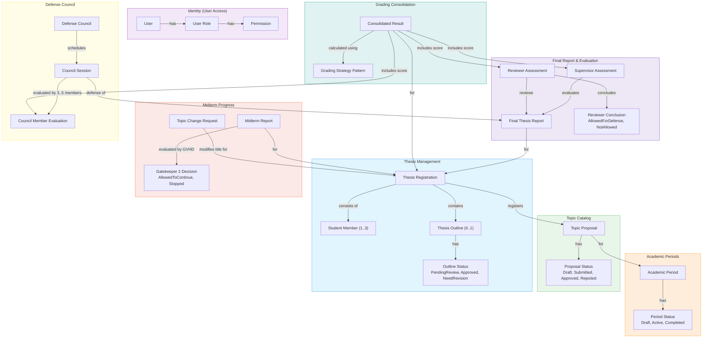

---

## 3. Mô hình C4 (C4 Architecture Model)

### 3.1 C1 — System Context Diagram

> 📄 **Mã nguồn PlantUML:** [C1_System_Context.puml](PlantUML/C1_System_Context.puml)

Biểu đồ ngữ cảnh hệ thống mô tả vị trí của UGTM trong môi trường trường đại học, tương tác với 7 nhóm tác nhân (Actors) và các hệ thống bên ngoài:

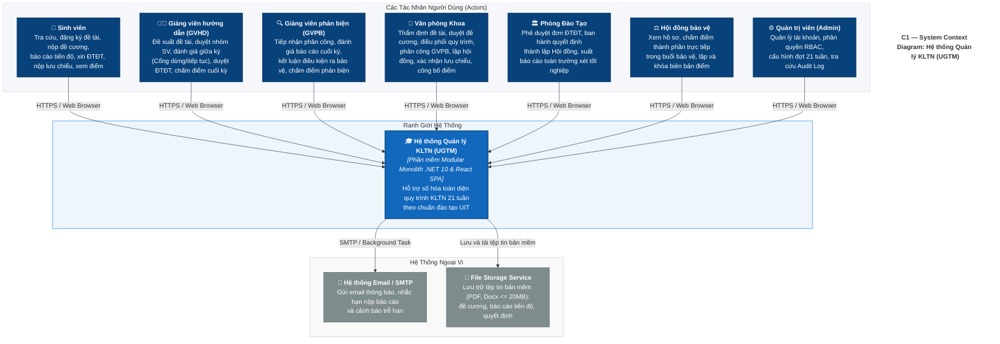

---

### 3.2 C2 — Container Diagram

> 📄 **Mã nguồn PlantUML:** [C2_Containers.puml](PlantUML/C2_Containers.puml)

Biểu đồ Container mô tả các khối runtime triển khai:

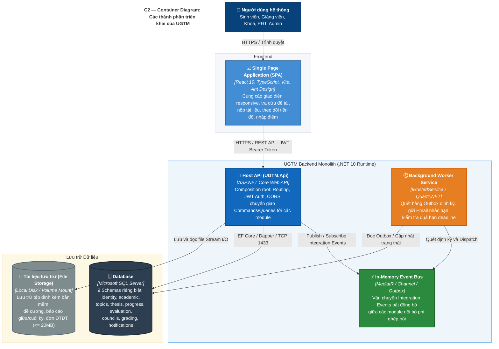

---

### 3.3 C3 — Component Diagram (High-Level View)

> 📄 **Mã nguồn PlantUML:** [C3_Components_HighLevel.puml](PlantUML/C3_Components_HighLevel.puml)

Biểu đồ thành phần cấp cao thể hiện 9 module nghiệp vụ bên trong khối Backend Modular Monolith và mối liên kết với `BuildingBlocks`:

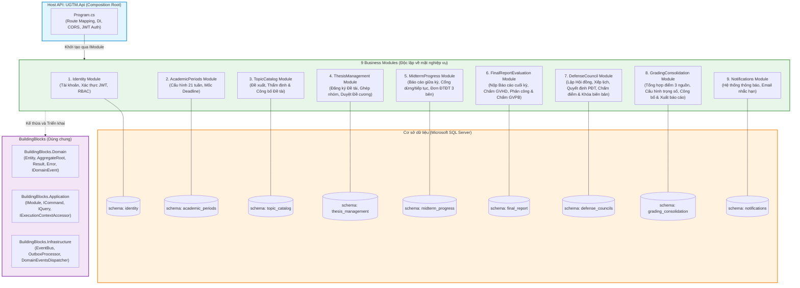

---

### 3.4 C3 — Component Diagram (Module Deep-Dive: Clean Architecture 4 Layer)

> 📄 **Mã nguồn PlantUML:** [C3_Components_ModuleDeepDive.puml](PlantUML/C3_Components_ModuleDeepDive.puml)

Mỗi module trong hệ sinh thái UGTM được chuẩn hóa thành 4 layer riêng biệt:

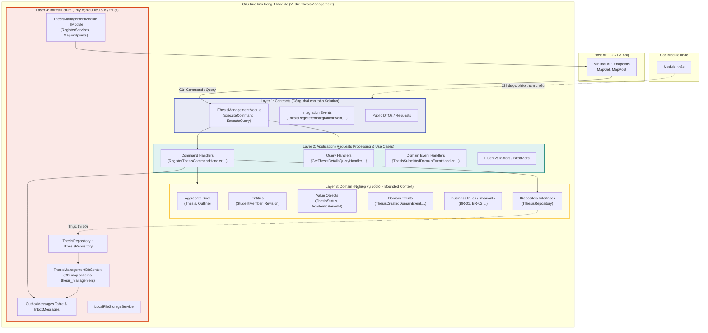

---

### 3.5 C4 — Code Diagram (Thesis Aggregate Model)

> 📄 **Mã nguồn PlantUML:** [C4_Code_Aggregate.puml](PlantUML/C4_Code_Aggregate.puml)

Biểu đồ lớp mã nguồn mô tả mô hình Thực thể Miền (Domain Aggregate) đại diện cho đề tài khóa luận trong phân hệ đăng ký & đề cương:

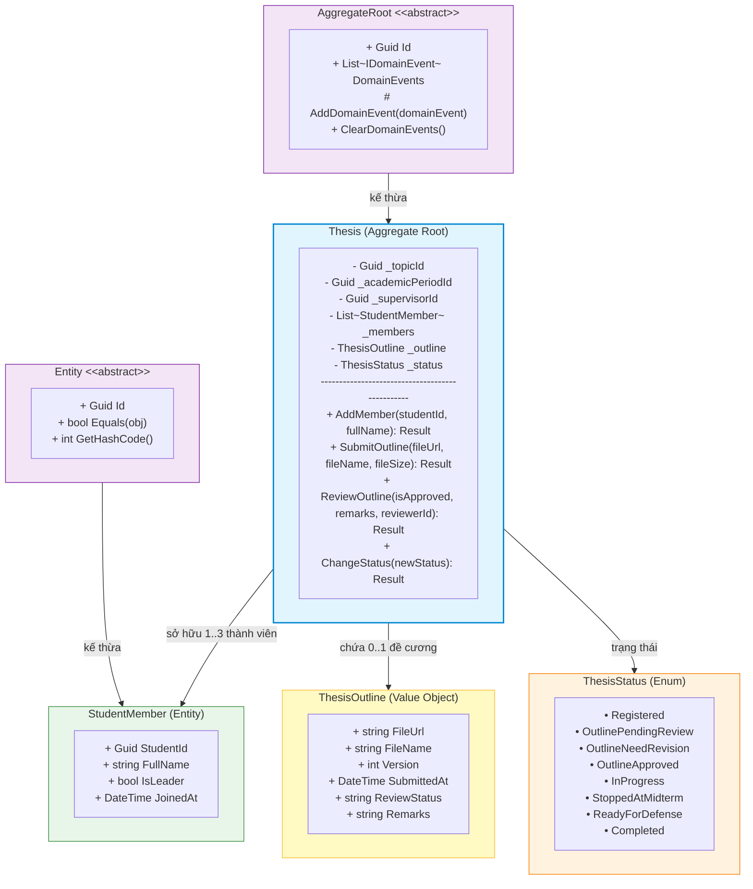

---

## 4. Mô hình Xử lý Yêu cầu qua CQRS

### 4.1 Phân tách Write Model & Read Model (CQRS Architecture)

> 📄 **Mã nguồn PlantUML:** [CQRS_Architecture.puml](PlantUML/CQRS_Architecture.puml)

Tách biệt rạch ròi giữa tác vụ ghi dữ liệu (Write Model tuân thủ Domain Model, Outbox, Transaction) và tác vụ đọc dữ liệu (Read Model dùng Direct SQL / Dapper tối ưu hóa tốc độ):

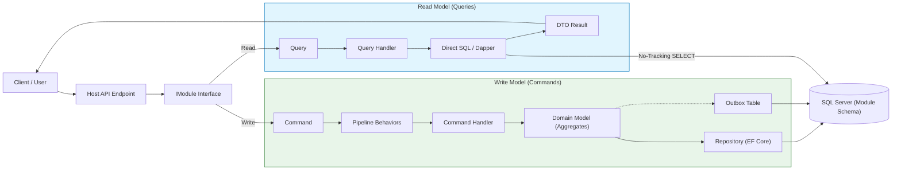

---

### 4.2 Luồng xử lý Command & Query (Sequence Flow)

> 📄 **Mã nguồn PlantUML:** [CQRS_Sequence.puml](PlantUML/CQRS_Sequence.puml)

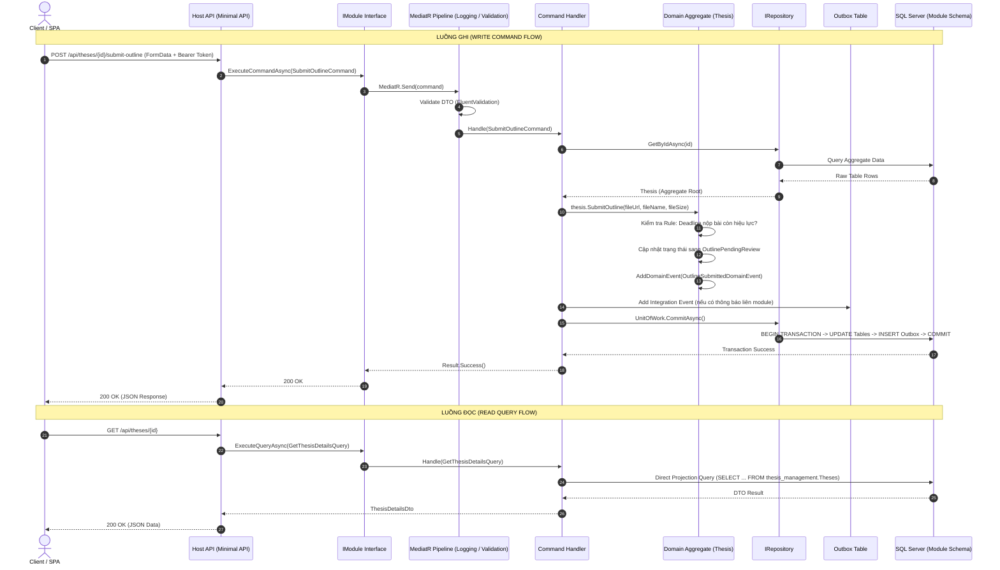

---

### 4.3 Cross-Cutting Concerns: Pipeline Behaviors / Decorator Pattern

> 📄 **Mã nguồn PlantUML:** [Pipeline_Decorators.puml](PlantUML/Pipeline_Decorators.puml)

Mọi Command trước khi đến được Command Handler đều đi qua chuỗi Pipeline Decorators để đảm bảo tính toàn vẹn và ghi vết:

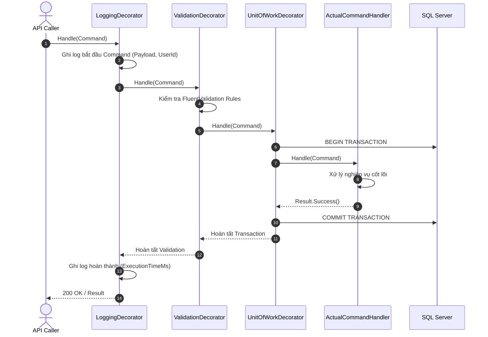

---

## 5. Tích hợp liên Module (Inter-Module Integration via Outbox & Event Bus)

> 📄 **Mã nguồn PlantUML:** [EventBus_Outbox_Integration.puml](PlantUML/EventBus_Outbox_Integration.puml)

Để các module hoàn toàn phân rã và không phụ thuộc chéo vào nhau, khi có sự kiện nghiệp vụ quan trọng, hệ thống sử dụng **Transactional Outbox Pattern** kết hợp với **In-Memory Event Bus**:

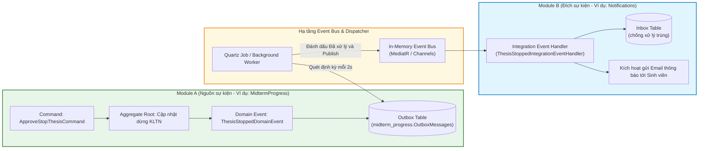

---

## 6. Bảo mật & Phân quyền (Security & Authentication Flow)

> 📄 **Mã nguồn PlantUML:** [Security_Authentication_Flow.puml](PlantUML/Security_Authentication_Flow.puml)

Xác thực phi trạng thái (Stateless) bằng ASP.NET Core Identity + JWT Bearer Token kết hợp phân quyền RBAC và Policy-Based:

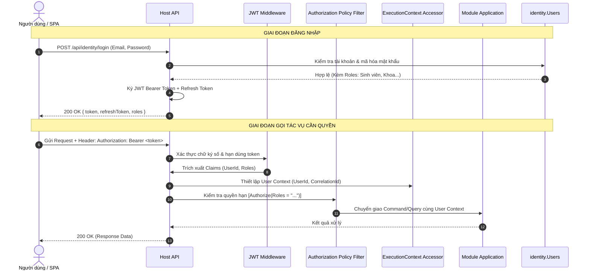

---

## 7. Kiến trúc Dữ liệu & Phân tách Schema (Multi-Schema Database Architecture)

> 📄 **Mã nguồn PlantUML:** [MultiSchema_Database.puml](PlantUML/MultiSchema_Database.puml)

Nhằm đảm bảo quy tắc DDD và tính sẵn sàng tách thành Microservices trong tương lai:
- **1 Database duy nhất**: `UGTM_Db`
- **Mỗi Module sở hữu Schema riêng biệt**:
  - `identity.*`: Quản lý người dùng, Roles, JWT refresh tokens, Audit log.
  - `academic.*`: Đợt KLTN, mốc 21 tuần, cấu hình deadline từng giai đoạn.
  - `topics.*`: Ngân hàng đề tài, đề xuất từ GVHD, duyệt đề tài của Khoa.
  - `thesis.*`: Đăng ký đề tài, thành viên nhóm, nộp & thẩm định đề cương.
  - `progress.*`: Báo cáo giữa kỳ, đơn xin đổi tên đề tài (ĐTĐT) 3 bên.
  - `evaluation.*`: Báo cáo cuối kỳ, bảng điểm thành phần GVHD, GVPB.
  - `councils.*`: Hội đồng chấm KLTN, quyết định thành lập của PĐT, biên bản điểm bảo vệ.
  - `grading.*`: Bảng tổng hợp điểm 3 nguồn, công thức trọng số Strategy, xuất dữ liệu.
  - `notifications.*`: Hàng đợi thông báo, mẫu email, nhật ký gửi tin.
- **Ràng buộc khóa ngoại**: Không dùng Foreign Key vật lý qua lại giữa các schema. Quan hệ liên module được duy trì qua các khóa logic định danh (GUIDs).

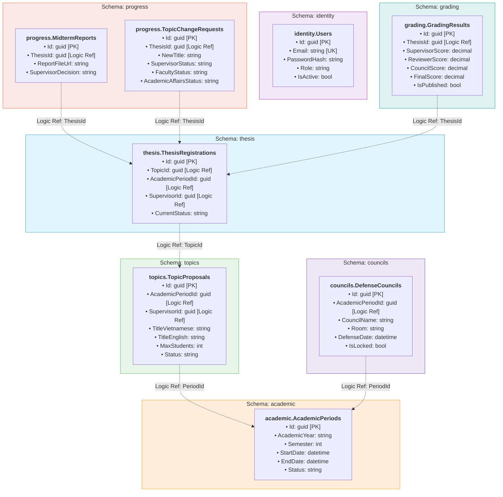

---

## 8. Biểu đồ Luồng Nghiệp vụ 7 Giai đoạn & 2 Cổng Kiểm soát (Gatekeeper Workflow)

> 📄 **Mã nguồn PlantUML:** [Gatekeeper_Workflow.puml](PlantUML/Gatekeeper_Workflow.puml)

Biểu đồ trạng thái và tương tác của toàn bộ quy trình chuẩn 21 tuần theo đặc tả nghiệp vụ:

```mermaid
stateDiagram-v2
    [*] --> GiaiDoan1 : Tuần 0 - 1
    
    state GiaiDoan1 {
        [*] --> GVHD_SoanDeTai
        GVHD_SoanDeTai --> Khoa_ThamDinhDeTai
        Khoa_ThamDinhDeTai --> Khoa_CongBoDeTai : Đạt
        Khoa_ThamDinhDeTai --> GVHD_SoanDeTai : Yêu cầu sửa
    }

    GiaiDoan1 --> GiaiDoan2 : Tuần 2 (Mở đăng ký)
    
    state GiaiDoan2 {
        [*] --> SV_DangKy_GhepNhom
        SV_DangKy_GhepNhom --> NopDeCuongChiTiet
        NopDeCuongChiTiet --> CongKiemSoat1_KhoaDuyetDeCuong
        
        state CongKiemSoat1_KhoaDuyetDeCuong <<choice>>
        CongKiemSoat1_KhoaDuyetDeCuong --> NeedRevision : Không đạt / Cần sửa
        NeedRevision --> NopDeCuongChiTiet : Nộp lại trước deadline
        CongKiemSoat1_KhoaDuyetDeCuong --> Approved_DeCuong : Đạt
    }

    GiaiDoan2 --> GiaiDoan3 : Tuần 3 - 10 (Thực hiện KLTN)

    state GiaiDoan3 {
        [*] --> ThucHienKLTN
        ThucHienKLTN --> DonXinDoiTenDeTai : Nếu có thay đổi
        state DonXinDoiTenDeTai {
            SV_TaoDon --> GVHD_XacNhan
            GVHD_XacNhan --> Khoa_Duyet
            Khoa_Duyet --> PDT_DuyetQuyetDinh
            PDT_DuyetQuyetDinh --> CapNhatDeCuongMoi
        }
        ThucHienKLTN --> NopBaoCaoGiuaKy : Tuần 10
    }

    GiaiDoan3 --> GiaiDoan4 : Tuần 10 (Cổng kiểm soát 2)

    state GiaiDoan4 {
        [*] --> CongKiemSoat2_GVHD_DanhGia
        state CongKiemSoat2_GVHD_DanhGia <<choice>>
        CongKiemSoat2_GVHD_DanhGia --> DungKLTN : Không đồng ý tiếp tục
        CongKiemSoat2_GVHD_DanhGia --> TiepTucKLTN : Đồng ý tiếp tục
    }

    DungKLTN --> [*] : Chấm dứt quy trình KLTN

    TiepTucKLTN --> GiaiDoan5 : Tuần 11 - 18

    state GiaiDoan5 {
        [*] --> NopBaoCaoCuoiKy
        NopBaoCaoCuoiKy --> GVHD_ChamDiemThanhPhan
        GVHD_ChamDiemThanhPhan --> Khoa_PhanCongGVPB
        Khoa_PhanCongGVPB --> GVPB_NhanXetVaChamDiem
        
        state GVPB_DanhGia <<choice>>
        GVPB_NhanXetVaChamDiem --> GVPB_DanhGia
        GVPB_DanhGia --> KhongChoBaoVe : Không đồng ý
        GVPB_DanhGia --> ChoBaoVe : Đồng ý cho bảo vệ
        ChoBaoVe --> SV_SuaBaoCaoTheoGVPB
    }

    KhongChoBaoVe --> [*] : Không đủ điều kiện ra Hội đồng

    GiaiDoan5 --> GiaiDoan6 : Tuần 19 - 20 (Bảo vệ Hội đồng)

    state GiaiDoan6 {
        [*] --> Khoa_LapDuThaoHoiDong
        Khoa_LapDuThaoHoiDong --> PDT_BanHanhQuyetDinhHD
        PDT_BanHanhQuyetDinhHD --> BuoiBaoVeTrucTiep
        BuoiBaoVeTrucTiep --> HoiDong_ChamDiemVaLapBienBan
        HoiDong_ChamDiemVaLapBienBan --> KhoaBienBanDiem : Khóa biên bản (Read-only)
        KhoaBienBanDiem --> NopLuuChieuBaoCaoFinal : SV sửa theo HĐ
        NopLuuChieuBaoCaoFinal --> Khoa_XacNhanLuuChieu
    }

    GiaiDoan6 --> GiaiDoan7 : Tuần 21 (Tổng hợp & Công bố)

    state GiaiDoan7 {
        [*] --> TongHopDiem3Nguon : GVHD, GVPB, Hội đồng
        TongHopDiem3Nguon --> ApDungTrongSoStrategy
        ApDungTrongSoStrategy --> Khoa_CongBoDiemChinhThuc
        Khoa_CongBoDiemChinhThuc --> XuatBaoCaoExcelPDF
        XuatBaoCaoExcelPDF --> PDT_XetCongNhanTotNghiep
    }

    GiaiDoan7 --> [*] : Kết thúc kỳ KLTN thành công
```
