# SITEMAP GIAO DIỆN HỆ THỐNG UGTM (University Graduation Thesis Management)

Tài liệu này hệ thống hóa toàn bộ kiến trúc thông tin, định tuyến và danh mục màn hình của nền tảng UGTM theo 5 không gian làm việc (Portals).

> 📌 **File PlantUML gốc (nét thẳng góc):** [`docs/PlantUML/Sitemap_UGTM.puml`](file:///c:/Projects/UGTM/docs/PlantUML/Sitemap_UGTM.puml)

---

## 1. Sơ Đồ Cây Tổng Quan (Mermaid Architecture)

```mermaid
graph TD
    Root["UGTM Portal (/)"] --> Auth["Xác thực & Công khai"]
    Root --> AppLayout["Khung App Shell (/portal)"]

    Auth --> Login["Đăng nhập SSO / Tài khoản trường (/login)"]
    Auth --> PublicTopics["Tra cứu Đề tài Công khai (/topics/public)"]

    AppLayout --> Student["Sinh viên (/student)"]
    AppLayout --> Lecturer["Giảng viên (GVHD / GVPB) (/lecturer)"]
    AppLayout --> Faculty["Khoa & Bộ môn (/faculty)"]
    AppLayout --> Academic["Phòng Đào tạo (/academic)"]
    AppLayout --> Admin["Quản trị Hệ thống (/admin)"]

    %% Student Sub-routes
    Student --> S_Dash["Dashboard Tiến độ (/student/dashboard)"]
    Student --> S_Topic["Đăng ký & Đề xuất Đề tài (/student/topics)"]
    Student --> S_Proposal["Nộp Đề cương Chi tiết (/student/proposal)"]
    Student --> S_Midterm["Báo cáo Tiến độ Định kỳ (/student/progress)"]
    Student --> S_Final["Nộp Khóa luận Cuối kỳ (/student/final-report)"]
    Student --> S_Defense["Lịch & Điểm Bảo vệ (/student/defense)"]
    Student --> S_ChangeReq["Đơn Đổi tên ĐT / GVHD (/student/change-request)"]

    %% Lecturer Sub-routes
    Lecturer --> L_Dash["Dashboard Giảng viên (/lecturer/dashboard)"]
    Lecturer --> L_MyTopics["Kho Đề tài Giảng viên ra (/lecturer/my-topics)"]
    Lecturer --> L_Guidance["Theo dõi & Đánh giá SV Hướng dẫn (/lecturer/supervising)"]
    Lecturer --> L_Review["Chấm Phản biện Đề cương & Đồ án (/lecturer/reviews)"]
    Lecturer --> L_Council["Hội đồng Chấm Bảo vệ (/lecturer/councils)"]

    %% Faculty Sub-routes
    Faculty --> F_ReviewProposal["Thẩm định Đề cương Khoa/Bộ môn (/faculty/proposals)"]
    Faculty --> F_AssignReviewer["Phân công Giảng viên Phản biện (/faculty/assign-reviewers)"]
    Faculty --> F_ManageCouncil["Thành lập Hội đồng Bảo vệ (/faculty/councils)"]
    Faculty --> F_ChangeApprove["Duyệt Đơn Đổi tên / Đổi GVHD (/faculty/change-requests)"]
    Faculty --> F_Stats["Thống kê Tiến độ Toàn khoa (/faculty/statistics)"]

    %% Academic & Admin Sub-routes
    Academic --> A_Periods["Quản lý Đợt KLTN & Deadline (/academic/periods)"]
    Academic --> A_Eligible["Danh sách SV Đủ điều kiện làm ĐA (/academic/eligible-students)"]
    Academic --> A_Consolidation["Tổng hợp Điểm & Xét Tốt nghiệp (/academic/grading)"]
    Admin --> Adm_Users["Tài khoản & Phân quyền RBAC (/admin/users)"]
    Admin --> Adm_Audit["Nhật ký Hệ thống (/admin/audit-logs)"]
```

---

## 2. Danh Mục Chi Tiết Màn Hình Theo Vai Trò (Screen Matrix)

### Cổng 1: Sinh viên (`/student`)
| Tuyến đường (Route) | Tên màn hình | Mục đích chính |
| :--- | :--- | :--- |
| `/student/dashboard` | Trang tổng quan | Xem tiến độ đề tài theo Stepper, các mốc deadline sắp tới |
| `/student/topics` | Đăng ký & Đề xuất đề tài | Xem kho đề tài của trường/khoa, đăng ký hoặc đề xuất đề tài mới |
| `/student/proposal` | Nộp Đề cương chi tiết | Tải file đề cương, xem kết quả thẩm định và nhận xét của Hội đồng |
| `/student/progress` | Báo cáo tiến độ | Gửi link mã nguồn, file báo cáo định kỳ theo tuần/tháng |
| `/student/final-report` | Nộp Khóa luận cuối kỳ | Nộp báo cáo hoàn chỉnh (PDF) và kết quả kiểm tra đạo văn |
| `/student/defense` | Lịch & Điểm bảo vệ | Xem ngày giờ, phòng bảo vệ, hội đồng và điểm số chính thức |
| `/student/change-request`| Đơn xin đổi tên ĐT / GVHD | Tạo đơn thay đổi 3 bên (Sinh viên -> GVHD -> Khoa duyệt) |

### Cổng 2: Giảng viên Hướng dẫn & Phản biện (`/lecturer`)
| Tuyến đường (Route) | Tên màn hình | Mục đích chính |
| :--- | :--- | :--- |
| `/lecturer/dashboard` | Dashboard Giảng viên | Thống kê số lượng SV đang hướng dẫn, lịch chấm phản biện |
| `/lecturer/my-topics` | Quản lý đề tài ra đợt này | Tạo đề tài mới, duyệt sinh viên xin vào nhóm đề tài |
| `/lecturer/supervising` | Theo dõi SV hướng dẫn | Đánh giá báo cáo tiến độ, cho phép hoặc từ chối sinh viên bảo vệ |
| `/lecturer/reviews` | Chấm phản biện | Phiếu chấm điểm phản biện kèm nhận xét chi tiết |
| `/lecturer/councils` | Hội đồng bảo vệ | Chấm điểm bảo vệ trực tiếp tại phòng hội đồng |

### Cổng 3: Khoa & Bộ môn (`/faculty`)
| Tuyến đường (Route) | Tên màn hình | Mục đích chính |
| :--- | :--- | :--- |
| `/faculty/proposals` | Thẩm định Đề cương | Thẩm định Đề cương chi tiết (Cổng kiểm soát 1: Approved / NeedRevision / Rejected) |
| `/faculty/midterm-reports` | Thẩm định Báo cáo giữa kỳ | Thẩm định Báo cáo giữa kỳ (Cổng kiểm soát 2 duy nhất: Approved / NeedRevision / Rejected) |
| `/faculty/assign-reviewers` | Phân công Giảng viên PB | Gán GVPB cho từng đề tài theo đúng chuyên ngành |
| `/faculty/councils` | Quản lý Hội đồng bảo vệ | Tạo các hội đồng chấm bảo vệ, phân công Chủ tịch, Thư ký, UV |
| `/faculty/change-requests` | Phê duyệt đơn thay đổi | Duyệt đơn đổi tên đề tài (bước 2/3 chuyển PĐT) |
| `/faculty/statistics` | Báo cáo & Thống kê | Xem biểu đồ tiến độ làm đồ án của toàn bộ sinh viên trong khoa |

### Cổng 4: Phòng Đào tạo & Quản trị Hệ thống (`/academic` & `/admin`)
| Tuyến đường (Route) | Tên màn hình | Mục đích chính |
| :--- | :--- | :--- |
| `/academic/periods` | Quản lý Đợt KLTN | Tạo đợt học kỳ mới, thiết lập các mốc thời gian deadline |
| `/academic/eligible-students` | Danh sách SV đủ điều kiện | Import/Export danh sách sinh viên đủ điều kiện làm khóa luận |
| `/academic/grading` | Tổng hợp điểm | Bảng tổng hợp điểm toàn khóa, xuất file quyết định tốt nghiệp |
| `/admin/users` | Quản lý tài khoản | Cấp phát tài khoản, phân quyền vai trò (Admin, Khoa, GV, SV) |
| `/admin/permissions` | Quản lý Quyền & Roles | Khởi tạo danh mục `Permissions` và phân quyền chi tiết cho `RolePermissions` |
| `/admin/audit-logs` | Nhật ký hệ thống | Theo dõi lịch sử thao tác dữ liệu của người dùng |
