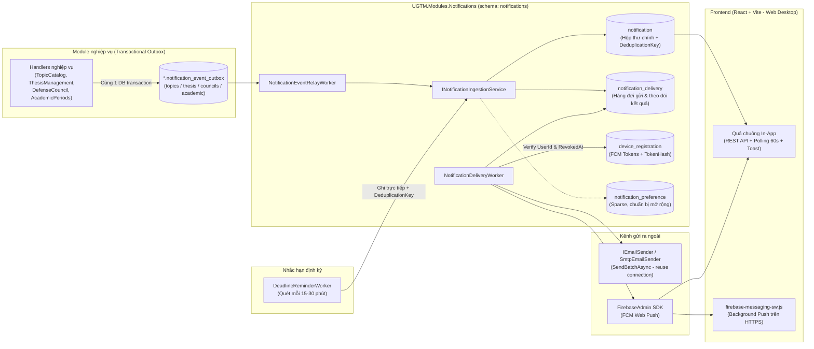

# Kế hoạch thiết kế & triển khai Hệ thống Thông báo (Notification System)

> **Trạng thái:** Bản thiết kế hợp nhất & đã chốt phạm vi (sẵn sàng triển khai từ Phase 1)  
> **Phạm vi:** Backend (`UGTM.Modules.Notifications` + Event Outbox tại các module nguồn) và Frontend (`React + Vite`, Web Desktop)

---

## 1. Tổng quan & nguyên tắc phân tách kênh

Hệ thống thông báo của UGTM được thiết kế theo mô hình **3 kênh phối hợp**:

1. **In-App Notification (Lưu DB – Quả chuông trên Header):**
   - Là **nguồn dữ liệu chính (source of truth)** cho mọi thông báo của người dùng.
   - Đảm bảo không bao giờ mất lịch sử thông báo (kể cả khi người dùng tắt quyền trình duyệt, dùng chế độ ẩn danh, hoặc không bật Push).
   - Mở rộng bảng `notifications.notification` đã có sẵn trong `UGTM.Modules.Notifications`.
2. **Web Push Notification (FCM – Firebase Cloud Messaging):**
   - Lớp thông báo đẩy xuống trình duyệt **Web Desktop** (Chrome, Edge, Firefox) **ngay cả khi người dùng không mở website**.
   - Đi kèm **100%** với mọi thông báo In-App (chỉ gửi đến các `device_registration` còn hiệu lực của đúng chủ sở hữu).
3. **Email Notification (SMTP):**
   - **Tái sử dụng** `IEmailSender` / `SmtpEmailSender` đã có sẵn trong `UGTM.Modules.Notifications`, bổ sung `SendBatchAsync` tái sử dụng kết nối `SmtpClient` để gửi nhanh theo lô mà vẫn gửi riêng từng người nhận (không dùng `To:`/`Bcc:` hàng loạt).
   - **Chỉ dùng cho các sự kiện đặc biệt quan trọng**: nhắc gần deadline (7 giai đoạn + Milestone + Hội đồng), xác nhận nộp bài cho sinh viên, phân công / đính chính lịch chấm & phản biện, nhóm bị dừng đề tài, và công bố điểm tổng kết.
   - **Email tổng hợp (Digest)** cho nhân sự (`Faculty`, `AcademicAffairs`, `Lecturer` GVHD/GVPB): gom toàn bộ đầu việc còn tồn đọng sắp đến hạn 24h thành **1 email riêng cho mỗi nhân sự**.

### Tham chiếu 7 giai đoạn chuẩn trong `KltnBatch.Stages`
| Thứ tự | `StageCode` | Tên giai đoạn |
| --- | --- | --- |
| 1 | `TOPIC_PREPARATION` | Chuẩn bị và công bố đề tài |
| 2 | `REGISTRATION_AND_SYLLABUS` | Đăng ký và đề cương |
| 3 | `PROGRESS_EXECUTION` | Thực hiện và theo dõi tiến độ |
| 4 | `MIDTERM_GATE` | Đánh giá giữa kỳ |
| 5 | `FINAL_EVALUATION` | Báo cáo cuối kỳ và phản biện |
| 6 | `DEFENSE` | Hội đồng và bảo vệ |
| 7 | `ARCHIVAL_AND_PUBLICATION` | Lưu chiểu và công bố kết quả |

---

## 2. Kiến trúc tổng thể

Mỗi module nghiệp vụ chỉ ghi vào **schema riêng của mình** (tuân thủ chặt chẽ kiến trúc Modular Monolith của UGTM, tương tự `AuditOutboxMessage`).

### Hai luồng tạo thông báo
1. **Luồng sự kiện nghiệp vụ (Transactional Event Outbox):**
   - Module nguồn (VD: `ThesisManagement`) lưu dữ liệu nghiệp vụ **và** ghi 1 bản ghi vào `thesis.notification_event_outbox` trong **cùng 1 DB transaction**.
   - `NotificationEventRelayWorker` đọc các sự kiện chưa xử lý và chuyển sang `Notifications`.
   - `Notifications` tạo các dòng `notification` + `notification_delivery` trong transaction riêng (khóa `DeduplicationKey` chống tạo trùng nếu relay chạy lại).
2. **Luồng nhắc gần Deadline (`DeadlineReminderWorker`):**
   - Chỉ đọc dữ liệu từ đợt `Open` (không có transaction ghi nghiệp vụ nguồn), nên gọi trực tiếp `INotificationIngestionService` với `DeduplicationKey` cố định để chống gửi trùng.

---

## 3. Danh mục sự kiện dùng SMTP Email (kèm In-App + FCM)

Tất cả các mục dưới đây đều có `Priority = Critical` và gửi đồng thời **In-App + FCM + SMTP Email** (không cho phép tắt).

### 3.1. Nhóm nhắc gần Deadline (Chạy tự động qua `DeadlineReminderWorker`)

| # | Mã sự kiện (`NotificationType`) | Nguồn deadline trong hệ thống | Người nhận | Điều kiện lọc (tránh gửi thừa) |
| --- | --- | --- | --- | --- |
| 1 | `TOPIC_PREPARATION_DEADLINE_SOON` | `Stage` Giai đoạn 1 (`TOPIC_PREPARATION`, `DeadlineAtUtc`) | **Lecturer** (GVHD) & **Faculty** | GVHD: còn đề tài `Draft` chưa gửi duyệt (gom digest). Khoa: còn đề tài `Submitted` chưa duyệt (gom digest) |
| 2 | `SYLLABUS_INITIAL_DEADLINE_SOON` | `ReviewGateConfiguration` (Gate = `Syllabus`, `InitialSubmissionDeadlineUtc`) | **Student** (thành viên đã xác nhận) | Nhóm thuộc đợt `Open`, `Group.Status == Registered` và **chưa nộp** đề cương lần đầu |
| 3 | `SYLLABUS_FINAL_DEADLINE_SOON` | `ReviewGateConfiguration` (Gate = `Syllabus`, `FinalClosureDeadlineUtc`) | **Student** | Nhóm có `Syllabus.Status == NeedRevision` (`SyllabusRevisionRequired`) và **chưa nộp lại** bản chỉnh sửa |
| 4 | `SYLLABUS_FACULTY_RESPONSE_DEADLINE_SOON` | `ReviewGateConfiguration` (Gate = `Syllabus`, `FacultyResponseDeadlineUtc`) | **Faculty** (quyền `thesis.review-gates.review`) | Đợt `Open` còn ≥ 1 hồ sơ đề cương `Submitted` chưa thẩm định (gom vào **email digest 24h**) |
| 5 | `MILESTONE_DEADLINE_SOON` | `ProgressMilestone.DeadlineUtc` (Giai đoạn 3 `PROGRESS_EXECUTION`) | **Student** | Nhóm đợt `Open`, `Group.Status == InProgress`, mốc tiến độ **chưa nộp** hoặc `NeedRevision` chưa nộp lại |
| 6 | `MIDTERM_INITIAL_DEADLINE_SOON` | `ReviewGateConfiguration` (Gate = `Midterm`, `InitialSubmissionDeadlineUtc`) | **Student** | Nhóm `InProgress` (đã qua Cổng 1) và **chưa nộp** báo cáo giữa kỳ lần đầu |
| 7 | `MIDTERM_FINAL_DEADLINE_SOON` | `ReviewGateConfiguration` (Gate = `Midterm`, `FinalClosureDeadlineUtc`) | **Student** | Nhóm có `MidtermReport.Status == NeedRevision` và **chưa nộp lại** bản chỉnh sửa |
| 8 | `MIDTERM_FACULTY_RESPONSE_DEADLINE_SOON` | `ReviewGateConfiguration` (Gate = `Midterm`, `FacultyResponseDeadlineUtc`) | **Faculty** (quyền `thesis.review-gates.review`) | Đợt `Open` còn ≥ 1 báo cáo giữa kỳ `Submitted` chưa thẩm định (gom vào **email digest 24h**) |
| 9 | `FINAL_REPORT_DEADLINE_SOON` | `Stage` Giai đoạn 5 (`FINAL_EVALUATION`, `DeadlineAtUtc`) | **Student** | Nhóm đã qua Cổng 2 (`MidtermReport.Status == Approved`), `Group.Status == InProgress` và **chưa nộp** báo cáo cuối kỳ |
| 10 | `ADVISOR_EVALUATION_DEADLINE_SOON` | `Stage` Giai đoạn 5 (`FINAL_EVALUATION`, `DeadlineAtUtc`) | **Lecturer** (GVHD) | GVHD có ≥ 1 nhóm đã nộp báo cáo cuối kỳ nhưng **chưa chấm / chưa chốt duyệt** ra phản biện (gom digest) |
| 11 | `REVIEWER_EVALUATION_DEADLINE_SOON` | `Stage` Giai đoạn 5 (`FINAL_EVALUATION`, `DeadlineAtUtc`) | **Lecturer** (GVPB) | GVPB có ≥ 1 nhóm được phân công (`ReviewerAssignment`) nhưng **chưa hoàn tất chấm / phát hành** đánh giá (gom digest) |
| 12 | `REVISED_FINAL_REPORT_DEADLINE_SOON` | `Council.DefenseDate` (hoặc `Stage` Giai đoạn 5 `DeadlineAtUtc`) | **Student** | Nhóm đã có nhận xét GVPB, đủ điều kiện nộp bản chỉnh sửa sau phản biện nhưng **chưa nộp** `RevisedAfterReviewer` |
| 13 | `COUNCIL_DEFENSE_UPCOMING_STUDENT` | `Council.DefenseDate` (`TimeSlot`, `Room`) | **Student** | Nhóm thuộc Hội đồng đã `Approved` và sắp đến ngày bảo vệ |
| 14 | `COUNCIL_DEFENSE_UPCOMING_MEMBER` | `Council.DefenseDate` (`TimeSlot`, `Room`) | **Lecturer / CouncilMember** | Thành viên (Chủ tịch, Thư ký, Ủy viên) của Hội đồng đã `Approved` sắp đến ngày bảo vệ |
| 15 | `COUNCIL_MINUTE_DEADLINE_SOON` | `Stage` Giai đoạn 6 (`DEFENSE`, `DeadlineAtUtc`) | **CouncilMember** (Chủ tịch / Thư ký) | Hội đồng đã qua `DefenseDate` nhưng **chưa khóa biên bản** hoặc **chưa nộp điểm về PDT** trước hạn Giai đoạn 6 |
| 16 | `ARCHIVAL_SUBMISSION_DEADLINE_SOON` | `Stage` Giai đoạn 7 (`ARCHIVAL_AND_PUBLICATION`, `DeadlineAtUtc`) | **Student** | Nhóm đủ điều kiện lưu chiểu nhưng **chưa nộp** hoặc cần bổ sung hồ sơ lưu chiểu |
| 17 | `ARCHIVAL_ADVISOR_CONFIRM_DEADLINE_SOON` | `Stage` Giai đoạn 7 (`ARCHIVAL_AND_PUBLICATION`, `DeadlineAtUtc`) | **Lecturer** (GVHD) | GVHD có ≥ 1 nhóm đã nộp lưu chiểu nhưng **chưa xác nhận** (gom digest) |
| 18 | `SCORE_SUMMARY_DEADLINE_SOON` | `Stage` Giai đoạn 7 (`ARCHIVAL_AND_PUBLICATION`, `DeadlineAtUtc`) | **AcademicAffairs** (quyền tổng hợp/công bố điểm) | Đợt `Open` còn nhóm **chưa tính / chưa công bố** bảng điểm tổng kết (gom vào **email digest 24h**) |
| 19 | `ARCHIVAL_CLOSURE_DEADLINE_SOON` | `Stage` Giai đoạn 7 (`ARCHIVAL_AND_PUBLICATION`, `DeadlineAtUtc`) | **AcademicAffairs** (quyền thẩm định lưu chiểu) | Đợt `Open` còn hồ sơ lưu chiểu **chưa duyệt / chưa chốt** (gom vào **email digest 24h**) |

> **Cơ chế gửi Email tổng hợp (Digest) & Gửi riêng từng người:**
> - **Nhân sự (`Faculty`, `AcademicAffairs`, `Lecturer`):** Gom toàn bộ các đầu việc còn tồn đọng sắp đến hạn trong 24h thành **1 email tổng hợp** cho **mỗi tài khoản nhân sự** (`To:` 1 người nhận/thư, tạo 1 `notification` + 1 `notification_delivery` riêng).
> - **Sinh viên:** Tạo **1 email cá nhân hóa riêng cho từng sinh viên** (ghi rõ tên SV, mã nhóm, tên đề tài, hạn chót, link trực tiếp) — **không** dùng `To:`/`Bcc:` hàng loạt để tránh lộ email, tránh bị phạt Spam và giữ cơ chế retry độc lập từng người. Tối ưu tốc độ bằng `SmtpEmailSender.SendBatchAsync` tái sử dụng 1 kết nối `SmtpClient` cho mỗi lô 20–30 thư.

### 3.2. Nhóm xác nhận nộp bài (Kích hoạt ngay sau khi Student nộp bài)

| # | Mã sự kiện (`NotificationType`) | Điểm kích hoạt trong Backend | Người nhận | Nội dung chính |
| --- | --- | --- | --- | --- |
| 20 | `SUBMISSION_CONFIRMED` | - `SubmitSyllabusHandler` (Đề cương – `/thesis/proposal`) - `SubmitProgressReportHandler` (Milestone – `/thesis/milestones`) - `SubmitMidtermReportHandler` (Giữa kỳ – `/thesis/midterm`) - `SubmitFinalReportHandler` (Cuối kỳ & Bản sửa sau PB – `/thesis/final-report`) - `SubmitFinalSubmissionHandler` (Lưu chiểu – `/thesis/archival`) | **Student** (tất cả thành viên đã xác nhận của nhóm) | Tên mốc nộp, phiên bản (`v1`, `v2`...), người thực hiện nộp, thời gian nộp (giờ VN), **tên tệp + dung lượng** (không đính kèm file gốc) + **link dẫn thẳng tới trang mốc nộp** |

### 3.3. Nhóm sự kiện trọng yếu, phân công & đính chính lịch (Kích hoạt ngay khi có thao tác)

| # | Mã sự kiện (`NotificationType`) | Điểm kích hoạt trong Backend | Người nhận | Nội dung chính |
| --- | --- | --- | --- | --- |
| 21 | `REVIEWER_ASSIGNED` | `CreateReviewerAssignmentHandler` | **Lecturer** (GVPB) | Tên đề tài, mã nhóm, đợt KLTN, thời hạn phản biện và link vào trang chấm phản biện |
| 22 | `COUNCIL_MEMBER_ASSIGNED` | `AddCouncilMembersHandler` / `ApproveCouncilHandler` | **Lecturer / CouncilMember** | Mã hội đồng, vai trò (Chủ tịch/Thư ký/Ủy viên), ngày/ca/phòng bảo vệ, danh sách nhóm và link vào không gian Hội đồng |
| 23 | `COUNCIL_SCHEDULE_UPDATED` | `UpdateCouncilScheduleHandler` | **Student** & **CouncilMember** thuộc hội đồng | Thông báo đính chính ngày bảo vệ / ca / phòng mới so với lịch cũ |
| 24 | `ASSIGNMENT_CANCELLED` | `CancelReviewerAssignmentHandler`, `RemoveCouncilMemberHandler` | **Lecturer / CouncilMember** bị gỡ phân công | Thông báo hủy phân công phản biện hoặc rút tên khỏi Hội đồng |
| 25 | `GROUP_STOPPED` | `ReviewSyllabusHandler` (Rejected), `ReviewMidtermReportHandler` (Rejected), `ReviewGateDeadlineEnforcementWorker` (Quá hạn), `DecideAdvisorEvaluationHandler` / `SaveReviewerEvaluationHandler` (Không đạt ra Hội đồng) | **Student** & **Lecturer (GVHD)** | Lý do dừng thực hiện đề tài, giai đoạn bị dừng và hướng dẫn liên hệ Khoa / GVHD |
| 26 | `SCORE_SUMMARY_PUBLISHED` | `PublishScoreSummaryHandler` | **Student** | Thông báo điểm tổng kết KLTN chính thức đã được công bố kèm link xem bảng điểm |
| 27 | `TOPIC_REVISION_REQUESTED` | `ReviewTopicHandler` (Khoa yêu cầu chỉnh sửa đề tài) | **Lecturer** (GVHD đề xuất đề tài) | Tên đề tài, đợt KLTN, nội dung góp ý / lý do yêu cầu chỉnh sửa từ Khoa và link mở thẳng trang chỉnh sửa đề tài (`/topics/propose`) |

> **Ghi chú (tránh trùng lặp):** Các email hệ thống đã có sẵn (`Identity`: kích hoạt tài khoản, OTP/reset password; `ThesisManagement`: lời mời đăng ký cặp đôi, GVHD gán SV vào đề tài, hết hạn lời mời) được **giữ nguyên**, không viết lại trùng lặp.

---

## 4. Danh mục sự kiện chỉ dùng In-App + FCM (xuyên suốt vòng đời)

Các sự kiện dưới đây có `Priority = Normal`, **không gửi SMTP**, chỉ ghi hộp thư **In-App** và đẩy **FCM Web Push**:

| Phân hệ | Sự kiện | Người nhận |
| --- | --- | --- |
| **AcademicPeriods** | Mở đợt KLTN mới; cập nhật lịch các giai đoạn / gia hạn deadline | Student, Lecturer, Faculty, AcademicAffairs |
| **TopicCatalog** | GVHD gửi đề tài chờ duyệt | Faculty |
| **TopicCatalog** | Khoa duyệt / từ chối đề tài *(trường hợp yêu cầu chỉnh sửa → `TOPIC_REVISION_REQUESTED` gửi thêm SMTP ở mục 3.3)* | Lecturer (GVHD) |
| **ThesisManagement – Đăng ký** | Bạn cùng nhóm xác nhận / từ chối lời mời; nhóm đăng ký thành công | Student (thành viên còn lại), Lecturer (GVHD) |
| **ThesisManagement – Đề cương** | SV nộp / nộp lại đề cương *(GVHD & Khoa nhận In-App/FCM; SV nhận thêm mail xác nhận mục 3.2)* | Faculty, Lecturer (GVHD) |
| **ThesisManagement – Đề cương** | Khoa thẩm định đề cương (`Approved` / `NeedRevision`) *(`Rejected` → `GROUP_STOPPED` gửi thêm SMTP)* | Student, Lecturer (GVHD) |
| **ThesisManagement – Milestone** | GVHD tạo mốc tiến độ mới; GVHD đánh giá mốc (`Accepted` / `NeedRevision`) | Student |
| **ThesisManagement – Milestone** | SV nộp báo cáo mốc tiến độ | Lecturer (GVHD) |
| **ThesisManagement – Đổi tên đề tài** | SV gửi yêu cầu đổi tên → GVHD duyệt → Khoa/PDT duyệt hoặc từ chối (kèm mở quyền nộp lại đề cương) | Lecturer, Faculty, AcademicAffairs, Student |
| **ThesisManagement – Giữa kỳ** | SV nộp / nộp lại báo cáo giữa kỳ | Faculty, Lecturer (GVHD) |
| **ThesisManagement – Giữa kỳ** | Khoa thẩm định giữa kỳ (`Approved` / `NeedRevision`) *(`Rejected` → `GROUP_STOPPED` gửi thêm SMTP)* | Student, Lecturer (GVHD) |
| **ThesisManagement – Cuối kỳ** | SV nộp báo cáo cuối kỳ; GVHD đồng ý chuyển phản biện; GVPB phát hành nhận xét; Khoa mở quyền nộp bản sửa sau phản biện | Lecturer (GVHD), Student, Faculty |
| **DefenseCouncil** | Phê duyệt quyết định thành lập hội đồng; mở khóa/nộp biên bản hội đồng | Student, CouncilMember, Faculty, AcademicAffairs |
| **ThesisManagement – Lưu chiểu** | SV nộp hồ sơ lưu chiểu → GVHD xác nhận → PDT phê duyệt hoặc yêu cầu bổ sung | Lecturer (GVHD), AcademicAffairs, Student |

---

## 5. Thiết kế Database, Index & Chiến lược Migration

Mọi ID dùng `uuid`, mọi mốc thời gian dùng `timestamptz` (UTC), mọi payload phiên bản dùng `jsonb`.

### 5.1. Mở rộng bảng `notifications.notification` (Hộp thư chính)

Giữ nguyên 7 cột hiện có (`Id`, `RecipientId`, `Title`, `Content`, `NotificationType`, `IsRead`, `CreatedAt`) và bổ sung các cột nullable/mặc định để tương thích ngược với dữ liệu cũ:

| Cột bổ sung | Kiểu dữ liệu | Mục đích |
| --- | --- | --- |
| `SourceModule` | `varchar(64)` | Module phát sinh (`ThesisManagement`, `DefenseCouncil`, `TopicCatalog`, `AcademicPeriods`, `Notifications`) |
| `SourceEventId` | `uuid` (nullable) | Liên kết `EventId` từ outbox module nguồn để truy vết |
| `DeduplicationKey` | `varchar(200)` (nullable) | Ngăn cùng 1 thông báo bị tạo nhiều lần cho 1 người (VD: `REMINDER:SYLLABUS_INITIAL:grpId:48h`) |
| `ResourceType` | `varchar(64)` (nullable) | Loại đối tượng liên quan (`StudentGroup`, `Syllabus`, `Council`, `ProgressMilestone`...) |
| `ResourceId` | `uuid` (nullable) | ID đối tượng liên quan |
| `AcademicBatchId` | `uuid` (nullable) | Đợt KLTN liên quan (phục vụ hiển thị/lọc theo đợt) |
| `ActionPath` | `varchar(500)` (nullable) | Đường dẫn nội bộ Frontend (VD: `/thesis/proposal`, `/councils/grading`) |
| `Priority` | `varchar(20)` (default `'Normal'`) | `'Normal'` \| `'Critical'` |
| `ReadAt` | `timestamptz` (nullable) | Thời điểm đánh dấu đã đọc (cập nhật song song với `IsRead = true`; bản ghi cũ giữ `null`) |
| `ExpiresAt` | `timestamptz` (nullable) | Thời điểm hết giá trị hành động (nếu có) |

### 5.2. Ba bảng mới trong schema `notifications`

1. **`notifications.device_registration`** — Quản lý đích nhận FCM Web Push (1 profile trình duyệt = 1 registration):
   - `Id` (`uuid`, PK)
   - `UserId` (`uuid`, not null)
   - `InstallationId` (`varchar(128)`, not null — định danh profile trình duyệt từ Frontend)
   - `Token` (`text`, not null — **bảo vệ bằng `IDataProtector`**, tuyệt đối không ghi vào log)
   - `TokenHash` (`varchar(64)`, not null — SHA-256 hex dùng cho lookup & unique constraint)
   - `Platform` (`varchar(30)`, default `'web'`)
   - `UserAgent` (`varchar(256)`, nullable)
   - `CreatedAt`, `LastSeenAt` (`timestamptz`, not null)
   - `RevokedAt` (`timestamptz`, nullable — set khi logout, đổi tài khoản, hoặc FCM báo `Unregistered`)

2. **`notifications.notification_delivery`** — Kiêm hàng đợi gửi (delivery outbox) và theo dõi kết quả theo từng kênh/đích:
   - `Id` (`uuid`, PK)
   - `NotificationId` (`uuid`, FK → `notifications.notification.id`)
   - `Channel` (`varchar(20)` — `'Email'` \| `'Fcm'`)
   - `Destination` (`varchar(256)` — địa chỉ email hoặc `DeviceRegistrationId`)
   - `Status` (`varchar(30)` — `'Pending'` \| `'Processing'` \| `'Accepted'` \| `'RetryScheduled'` \| `'FailedPermanent'` \| `'Skipped'`)
   - `AttemptCount` (`int`, default `0`)
   - `NextAttemptAt` (`timestamptz`, not null)
   - `LastErrorCode` (`varchar(100)`, nullable), `LastErrorMessage` (`text`, nullable)
   - `PayloadJson` (`jsonb`, nullable — chứa email subject/HTML hoặc FCM data payload)
   - `CreatedAt` (`timestamptz`, not null), `SentAt` (`timestamptz`, nullable)

3. **`notifications.notification_preference`** — Bảng sparse lưu tùy chọn nhận thông báo (chuẩn bị sẵn schema, chưa làm UI ở bản đầu):
   - `Id` (`uuid`, PK)
   - `UserId` (`uuid`, not null)
   - `Category` (`varchar(64)`, not null)
   - `Channel` (`varchar(20)`, not null)
   - `IsEnabled` (`bool`, not null)
   - `UpdatedAt` (`timestamptz`, not null)
   - *(Quy tắc cứng: chỉ lưu lựa chọn khác mặc định; các thông báo `Priority = Critical` luôn bỏ qua preference để đảm bảo không bị tắt nhầm.)*

### 5.3. Bảng Event Outbox tại các module nguồn phát sinh sự kiện
Chỉ thêm ở 4 module thực sự phát sinh sự kiện nghiệp vụ cần thông báo:
- `topics.notification_event_outbox`
- `thesis.notification_event_outbox`
- `councils.notification_event_outbox`
- `academic.notification_event_outbox`

Cấu trúc thống nhất:
- `Id` (`uuid`, PK), `EventId` (`uuid`, UNIQUE), `EventType` (`varchar(100)`), `PayloadVersion` (`int`, default `1`), `PayloadJson` (`jsonb`), `CreatedAt` (`timestamptz`), `ProcessedAt` (`timestamptz`, nullable), `AttemptCount` (`int`, default `0`), `NextAttemptAt` (`timestamptz`), `LastErrorCode` (`varchar(100)`, nullable).

### 5.4. Bộ Index & Constraint bắt buộc ngay từ đầu

| Bảng | Index / Constraint | Mục đích |
| --- | --- | --- |
| `notifications.notification` | `IX (recipient_id, created_at DESC, id DESC)` | Phân trang ổn định (keyset/offset không nhảy dòng) |
| `notifications.notification` | Partial `IX (recipient_id, created_at DESC) WHERE is_read = false` | Đếm `unread-count` và lọc chưa đọc siêu nhanh |
| `notifications.notification` | Partial `UNIQUE (recipient_id, deduplication_key) WHERE deduplication_key IS NOT NULL` | Chống tạo trùng thông báo cho cùng 1 người |
| `notifications.device_registration` | `UNIQUE (token_hash)` | Chống trùng token trong cùng Firebase project |
| `notifications.device_registration` | Partial `IX (user_id) WHERE revoked_at IS NULL` | Tra cứu nhanh các thiết bị còn hoạt động của user |
| `notifications.notification_delivery` | `UNIQUE (notification_id, channel, destination)` | Chống gửi trùng cùng 1 thông báo tới cùng 1 đích |
| `notifications.notification_delivery` | Partial `IX (next_attempt_at) WHERE status IN ('Pending', 'RetryScheduled')` | Worker poll hàng đợi cực nhanh |
| `notifications.notification_preference` | `UNIQUE (user_id, category, channel)` | Đảm bảo mỗi cặp tùy chọn là duy nhất |
| `*.notification_event_outbox` | Partial `IX (next_attempt_at) WHERE processed_at IS NULL` | Relay worker poll sự kiện chưa xử lý cực nhanh |

### 5.5. Chiến lược Migration an toàn
- Tạo migration bổ sung (additive) tập trung tại `UGTM.Database.Migrations`, giữ nguyên 100% dữ liệu cũ trong `notifications.notification`.
- Kiểm thử migration trên DB dev có sẵn dữ liệu cũ + kiểm thử các unique constraint chống trùng.
- Bật worker và từng nhóm sự kiện bằng feature flag (`Notifications:Delivery:Enabled`, `Notifications:Fcm:Enabled`, `Notifications:Reminders:Enabled`).

---

## 6. Thiết kế Backend

### 6.1. REST API Endpoints (`NotificationsModule`)
- `GET /api/notifications?pageNumber=1&pageSize=20&unreadOnly=false` — lấy danh sách thông báo của user hiện tại (sắp xếp `CreatedAt DESC, Id DESC`).
- `GET /api/notifications/unread-count` — trả về `{ unreadCount }`.
- `PATCH /api/notifications/{id:guid}/read` — cập nhật `IsRead = true` và `ReadAt = nowUtc`.
- `PATCH /api/notifications/read-all` — đánh dấu tất cả thông báo chưa đọc của user hiện tại.
- `POST /api/notifications/devices` — đăng ký / cập nhật `device_registration` (`InstallationId`, `Token`, `Platform`); nếu `TokenHash` đã tồn tại thuộc user khác thì thu hồi/chuyển quyền sở hữu an toàn.
- `DELETE /api/notifications/devices/{installationId}` — đặt `RevokedAt = nowUtc` khi logout.

### 6.2. Background Workers
1. **`NotificationEventRelayWorker` (mỗi 5–10 giây):**
   - Quét các bảng `*.notification_event_outbox` có `ProcessedAt IS NULL` và `NextAttemptAt <= nowUtc`.
   - Ánh xạ `EventType` + `PayloadJson` → tạo `notification` (có `DeduplicationKey`) và các `notification_delivery` (`Email` / `Fcm`) trong `NotificationsDbContext`.
   - Đánh dấu `ProcessedAt = nowUtc` ở module nguồn.
2. **`NotificationDeliveryWorker` (mỗi 5–10 giây):**
   - Quét `notifications.notification_delivery` có `Status IN ('Pending', 'RetryScheduled')` và `NextAttemptAt <= nowUtc`, chuyển sang `Processing`.
   - **Nhánh `Email`:** Gom thành lô 20–30 bản ghi và gọi `IEmailSender.SendBatchAsync(...)` (mở 1 kết nối `SmtpClient` duy nhất, gửi riêng từng thư, cập nhật `Accepted` hoặc `RetryScheduled` / `FailedPermanent` theo từng bản ghi).
   - **Nhánh `Fcm`:** Trước khi gửi, **kiểm tra lại `device_registration`** đảm bảo `RevokedAt == null` và `UserId == notification.RecipientId` (nếu không khớp thì đánh dấu `Skipped`). Gửi qua `FirebaseAdmin` SDK; nếu FCM trả `Unregistered` / `InvalidArgument` thì tự động set `RevokedAt = nowUtc` và `Status = FailedPermanent`.
   - Exponential backoff retry: 1 phút → 5 phút → 15 phút → tối đa 5 lần rồi chuyển `FailedPermanent` và log cảnh báo (không log token thô).
3. **`DeadlineReminderBackgroundService` (mỗi 15–30 phút):**
   - Quét đợt KLTN đang `Open` cho đủ 19 mốc deadline (mục 3.1).
   - Gom digest cho nhân sự (`StaffLeadTimeHours = [24]`), gửi cá nhân hóa cho sinh viên (`StudentLeadTimeHours = [48, 24]`).
   - Gắn `DeduplicationKey` cố định `REMINDER:{EventType}:{BatchOrEntityId}:{ThresholdHours}h` (kết hợp unique `(RecipientId, DeduplicationKey)` trên `notification`) để chống gửi lặp tuyệt đối.

---

## 7. Thiết kế Frontend (`React + Vite` — Web Desktop)

### 7.1. Tích hợp Firebase Web Push (HTTPS)
1. Cài package `firebase` (`firebase/app`, `firebase/messaging`).
2. Khai báo biến môi trường `VITE_FIREBASE_*` và `VITE_FIREBASE_VAPID_KEY` (cập nhật `.env.example`).
3. Tạo `frontend/public/firebase-messaging-sw.js`:
   - Nhận `onBackgroundMessage` → hiển thị OS notification kèm icon UGTM và `data.actionPath`.
   - Xử lý `notificationclick` → focus tab UGTM đang mở hoặc mở tab mới tới `actionPath`.
4. Tạo `frontend/src/shared/notifications/fcmClient.ts`:
   - Lưu `installationId` (UUID sinh 1 lần vào `localStorage`) để định danh profile trình duyệt.
   - Xin quyền thông báo khi người dùng chủ động bấm nút bật (không tự bật popup ép buộc khi vừa tải trang).
   - Lấy token qua `getToken(messaging, { vapidKey, serviceWorkerRegistration })` và gọi `POST /api/notifications/devices`.
   - **Foreground (`onMessage`):** Khi tab đang mở, hiện toast bằng `notify.info(...)` sẵn có và `queryClient.invalidateQueries({ queryKey: ['notifications'] })`.
   - **Logout (`AuthContext.logout`):** Gọi `DELETE /api/notifications/devices/{installationId}` và `deleteToken(messaging)` để tránh nhận nhầm thông báo của tài khoản trước trên máy dùng chung.

### 7.2. Giao diện Notification Center (In-App)
- Nút **quả chuông** trên Topbar/Header kèm badge số lượng chưa đọc (polling dự phòng nhẹ mỗi 60s cho user không bật Push; chưa dùng SignalR ở bản đầu).
- Popover/Drawer hiển thị danh sách thông báo:
  - Tab lọc: *Tất cả* / *Chưa đọc*.
  - Nút *Đánh dấu tất cả đã đọc*.
  - Banner/nút nhẹ cho user chưa bật Push: *"Bật thông báo trình duyệt để nhận nhắc deadline ngay cả khi đóng tab"*.
  - Bấm vào thông báo → gọi `PATCH /read` và điều hướng tới `actionPath`.

---

## 8. Lộ trình triển khai theo từng giai đoạn

| Giai đoạn | Nội dung chính | Kết quả kiểm chứng |
| --- | --- | --- |
| **Phase 1: Schema DB + Migration + In-App** | Mở rộng `notification`, thêm `device_registration`, `notification_delivery`, `notification_preference` và 4 bảng `*.notification_event_outbox` + migration tại `Database.Migrations` (đủ index & partial unique constraint); xây dựng `INotificationIngestionService`, 6 REST APIs và UI quả chuông In-App | Migration chạy sạch trên DB có dữ liệu cũ; test chống trùng `DeduplicationKey`; tạo thông báo hiện ngay trên quả chuông, đánh dấu đã đọc, nhảy đúng `actionPath` |
| **Phase 2: FCM Web Push + HTTPS** | Setup Firebase Console, cấu hình **HTTPS**, tích hợp `FirebaseAdmin` + `IDataProtector` vào `NotificationDeliveryWorker`, thêm `firebase-messaging-sw.js` & `fcmClient.ts` (Web Desktop), xử lý login/logout & thu hồi token chết | Đóng tab trình duyệt trên HTTPS → bắn Push test → máy tính nhận banner thông báo, click mở đúng trang; đổi tài khoản không nhận nhầm thông báo |
| **Phase 3: SMTP Email qua `NotificationDeliveryWorker`** | Bổ sung `SendBatchAsync` (tái sử dụng kết nối `SmtpClient`) vào `IEmailSender` / `SmtpEmailSender`; tích hợp nhánh `Channel == Email` trong `NotificationDeliveryWorker`; xây dựng bộ HTML email template chuẩn UGTM (nhắc hạn SV, digest 24h Khoa/GV/PDT, xác nhận nộp bài, phân công/lịch, dừng đề tài, công bố điểm) | Gửi thử sự kiện `Critical` → nhận đồng thời In-App + FCM + Email SMTP; test retry khi SMTP lỗi tạm |
| **Phase 4: Transactional Outbox & Trigger nghiệp vụ** | Xây dựng `NotificationEventRelayWorker`; gắn ghi `*.notification_event_outbox` vào 5 luồng xác nhận nộp bài (mục 3.2), 6 nhóm sự kiện trọng yếu/phân công (mục 3.3) và các handler vòng đời In-App + FCM (mục 4) | Test end-to-end: SV nộp bài nhận mail xác nhận; phân công GVPB/Hội đồng gửi đủ 3 kênh; duyệt đề tài/đề cương/giữa kỳ gửi In-App + FCM; DB rollback không phát sinh thông báo ảo |
| **Phase 5: `DeadlineReminderBackgroundService`** | Xây dựng worker quét định kỳ cho đủ 19 mốc nhắc deadline (mục 3.1) với `StudentLeadTimeHours = [48, 24]`, `StaffLeadTimeHours = [24]` (gom digest tổng hợp), `DeduplicationKey` và lọc người đã hoàn thành | Unit test toàn bộ 19 mốc (test chống gửi trùng, test gom digest 24h cho Khoa/GV/PDT, test bỏ qua nhóm đã nộp/đã duyệt) |

---

## 9. Các quyết định đã chốt

1. **Thiết kế DB & Transactional Outbox:** Áp dụng bộ schema chuẩn hóa của team (`notification` mở rộng + `device_registration` có `TokenHash`/`RevokedAt` + `notification_delivery` + `notification_preference` sparse + `*.notification_event_outbox` tại 4 module nguồn) cùng đầy đủ partial index và unique constraint chống trùng.
2. **Email tổng hợp (Digest) & Gửi riêng từng người:**
   - Nhân sự (`Faculty`, `AcademicAffairs`, `Lecturer`): gom toàn bộ đầu việc tồn đọng sắp đến hạn 24h thành **1 email tổng hợp riêng cho mỗi tài khoản nhân sự**.
   - Sinh viên: gửi **1 email cá nhân hóa riêng cho từng sinh viên** (không dùng `To:`/`Bcc:` hàng loạt), tối ưu tốc độ bằng `SmtpEmailSender.SendBatchAsync` tái sử dụng kết nối SMTP.
3. **Triển khai HTTPS:** Cấu hình luôn **HTTPS** ở Phase 2 cùng FCM Web Push để Service Worker chạy chuẩn.
4. **Tinh giảm hợp lý cho bản v1:**
   - **Không dùng SignalR** ở bản đầu (dùng FCM foreground `onMessage` + polling 60s; schema DB giữ sẵn khả năng mở rộng SignalR về sau).
   - **Không hỗ trợ iOS / Mobile / PWA** (chỉ tập trung **Web Desktop**: Chrome, Edge, Firefox).
   - **`notification_preference`:** Tạo bảng sparse sẵn trong DB nhưng chưa dựng UI cấu hình phức tạp ở Phase 1; mọi thông báo `Priority = Critical` luôn bắt buộc gửi.
   - **`DeadlineReminderWorker`:** Ghi trực tiếp vào `Notifications` với `DeduplicationKey` (không đi vòng qua outbox của module nguồn).
5. **Ngưỡng nhắc deadline:** `StudentLeadTimeHours = [48, 24]` và `StaffLeadTimeHours = [24]` (cấu hình trong `appsettings.json` để dễ chỉnh khi demo/test).
6. **Chính sách dọn dữ liệu (Retention):** Chốt kèm khi triển khai Phase 5 (gợi ý: dọn `notification_delivery` và `*.notification_event_outbox` đã xử lý thành công sau 30–90 ngày; giữ lịch sử `notifications.notification` theo năm học/đợt KLTN).
